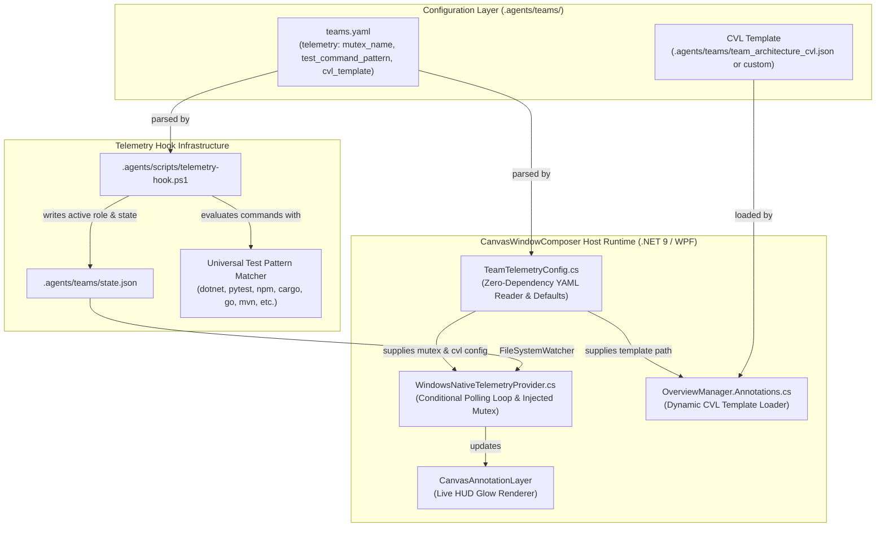

# Architecture Plan: Config-Driven Telemetry & Universal Multi-Language Test Detection

**Target Repository**: `schnepg1/CanvasWindowComposer`  
**Target Branch**: `window_linking_workflows`  
**Architect**: System Architect & Feature Planner Subagent  
**Date**: November 8, 2026  
**Status**: APPROVED / READY FOR IMPLEMENTATION (`PLAN_READY`)  
**Task ID**: `config_driven_telemetry`

---

## 1. Executive Summary & Problem Statement

CanvasWindowComposer's agent orchestration framework currently couples telemetry and test execution to Windows desktop testing via a hardcoded Win32 named mutex (`Global\CanvasWindowComposer.Tests`) polled continuously every 300ms, and a PowerShell hook that only recognizes `Run-Tests|dotnet test`.

To enable CanvasWindowComposer's agent orchestration framework to operate as a **universal, vendor-neutral engine across any software or content project** (such as Python, Node.js, Rust, Go, Java, or documentation projects), telemetry and test runner detection must be completely configuration-driven:

1. **Config-Driven Mutex Probing (`WindowsNativeTelemetryProvider.cs`)**:
   - Decouple the hardware named mutex from hardcoded constants.
   - Allow configuration via `teams.yaml` or constructor injection.
   - If the mutex name is null, empty (`""`), or not configured, **completely disable the 300ms background polling loop**, incurring zero polling timer overhead and zero coupling to Windows desktop testing.
   - Preserve 100% backward compatibility for CanvasWindowComposer desktop integration tests.

2. **Universal Multi-Language Test Command Detection (`telemetry-hook.ps1`)**:
   - Eliminate hardcoded C# test runner filters.
   - Check `teams.yaml` for an optional `telemetry.test_command_pattern`.
   - Provide a built-in universal default regex recognizing standard test runners across all major programming ecosystems:
     `Run-Tests|dotnet test|pytest|python -m unittest|npm test|yarn test|pnpm test|cargo test|go test|mvn test|gradle test`

3. **Pluggable CVL Template Specification (`teams.yaml` & `OverviewManager.Annotations.cs`)**:
   - Allow `teams.yaml` to specify the active Canvas Visualization Language (CVL) template path via `telemetry.cvl_template`.
   - Default to `.agents/teams/team_architecture_cvl.json` if omitted.
   - Update `OverviewManager.Annotations.cs:LoadTeamArchitectureCvl` to dynamically load the configured template.

4. **Zero External Dependency & Strict CI Compliance**:
   - Implemented without introducing third-party NuGet packages (e.g. YamlDotNet), preserving `packages.lock.json` integrity and `dotnet restore --locked-mode` in CI.
   - Lightweight, robust text/regex parsers for YAML configuration in both C# and PowerShell.

---

## 2. Component & Architecture Impact Analysis



### Component Change Manifest

| Component | File Path | Impact | Description |
| :--- | :--- | :--- | :--- |
| **Telemetry Config Model** | `Source/Workspace/TeamTelemetryConfig.cs` | **Create** | Dedicated configuration record, default constants, and dependency-free YAML parser for the `telemetry` block. |
| **Telemetry Provider** | `Source/Workspace/WindowsNativeTelemetryProvider.cs` | **Modify** | Adds optional `mutexName` parameter, disables polling timer when null/empty, exposes `IsPollingActive` and `MutexName`. |
| **Overview Controller** | `Source/Overlays/Overview/OverviewManager.Annotations.cs` | **Modify** | Updates `LoadTeamArchitectureCvl()` to resolve `telemetry.cvl_template` from `teams.yaml`. |
| **Agent Teams Schema** | `.agents/teams/teams.yaml` | **Modify** | Declares `telemetry:` configuration section with `mutex_name`, `test_command_pattern`, and `cvl_template`. |
| **Telemetry Lifecycle Hook** | `.agents/scripts/telemetry-hook.ps1` | **Modify** | Parses `teams.yaml`, evaluates multi-language test runner regex, and updates role status generically. |
| **Telemetry Tests** | `Tests/TelemetryTests.cs` | **Modify** | Adds unit tests for null/empty mutex, custom mutex name, YAML parsing, and multi-language test regexes. |

---

## 3. Detailed Specification & Design

### 3.1 `teams.yaml` Telemetry Schema

Add a top-level `telemetry:` block to `.agents/teams/teams.yaml`:

```yaml
# ==============================================================================
# Agent Teams Specification (teams.yaml)
# ==============================================================================
version: "1.0.0"
metadata:
  repository: "schnepg1/CanvasWindowComposer"
  project_type: "WPF / D3D / Win32 Native Desktop Application"
  concurrency_model: "Git Worktree Isolation + OS-level Named Mutex"

# ------------------------------------------------------------------------------
# Telemetry & Runtime Coordination Configuration
# ------------------------------------------------------------------------------
telemetry:
  # Win32 named mutex for desktop test serialization.
  # For non-desktop projects (Python, Node.js, Rust, Go), set to "" or omit to completely
  # disable the hardware mutex polling loop and eliminate background thread overhead.
  mutex_name: "Global\\CanvasWindowComposer.Tests"

  # Optional regex override for detecting test execution commands.
  # If omitted, defaults to universal multi-language pattern:
  #   Run-Tests|dotnet test|pytest|python -m unittest|npm test|yarn test|pnpm test|cargo test|go test|mvn test|gradle test
  test_command_pattern: "Run-Tests|dotnet test"

  # Active Canvas Visualization Language (CVL) template path.
  # Relative to workspace root or absolute path. Defaults to .agents/teams/team_architecture_cvl.json
  cvl_template: ".agents/teams/team_architecture_cvl.json"
```

#### Multi-Ecosystem Adaptability Examples:
- **Python Project** (`pytest`, `unittest`):
  ```yaml
  telemetry:
    mutex_name: ""
    test_command_pattern: "pytest|python -m unittest"
    cvl_template: ".agents/teams/team_architecture_cvl.json"
  ```
- **Node.js / Web Project** (`npm`, `yarn`, `vitest`):
  ```yaml
  telemetry:
    mutex_name: ""
    test_command_pattern: "npm test|yarn test|pnpm test|vitest"
  ```
- **Rust Project** (`cargo test`):
  ```yaml
  telemetry:
    mutex_name: ""
    test_command_pattern: "cargo test"
  ```

---

### 3.2 Telemetry Configuration Engine (`Source/Workspace/TeamTelemetryConfig.cs`)

A zero-dependency C# record reading the YAML block using compiled regular expressions:

```csharp
using System;
using System.IO;
using System.Text.RegularExpressions;

namespace CanvasDesktop;

public sealed record TeamTelemetryConfig(
    string? MutexName = null,
    string? TestCommandPattern = null,
    string? CvlTemplate = null)
{
    public const string DefaultNamedMutexName = @"Global\CanvasWindowComposer.Tests";
    public const string DefaultCvlTemplate = ".agents/teams/team_architecture_cvl.json";
    public const string DefaultTestCommandPattern =
        @"Run-Tests|dotnet test|pytest|python -m unittest|npm test|yarn test|pnpm test|cargo test|go test|mvn test|gradle test";

    private static readonly Regex TelemetryBlockRegex = new(
        @"(?ms)^telemetry:\s*\r?\n(?<block>(?:[ \t]+[^\r\n]+\r?\n?)+)",
        RegexOptions.Compiled);

    public static TeamTelemetryConfig Load(string? teamsYamlPath = null)
    {
        string? resolvedPath = ResolveTeamsYamlPath(teamsYamlPath);
        if (string.IsNullOrEmpty(resolvedPath) || !File.Exists(resolvedPath))
        {
            return new TeamTelemetryConfig();
        }

        try
        {
            string content = File.ReadAllText(resolvedPath);
            return ParseYaml(content);
        }
        catch
        {
            return new TeamTelemetryConfig();
        }
    }

    public static TeamTelemetryConfig ParseYaml(string yamlContent)
    {
        if (string.IsNullOrWhiteSpace(yamlContent))
            return new TeamTelemetryConfig();

        string? mutex = null;
        string? testPattern = null;
        string? cvl = null;

        var match = TelemetryBlockRegex.Match(yamlContent);
        if (match.Success)
        {
            string block = match.Groups["block"].Value;
            var lines = block.Split(new[] { "\r\n", "\r", "\n" }, StringSplitOptions.RemoveEmptyEntries);

            foreach (var rawLine in lines)
            {
                var line = rawLine.Trim();
                if (line.StartsWith("#") || string.IsNullOrWhiteSpace(line)) continue;

                int colonIdx = line.IndexOf(':');
                if (colonIdx <= 0) continue;

                string key = line.Substring(0, colonIdx).Trim();
                string val = line.Substring(colonIdx + 1).Trim();

                // Strip inline comment if outside quotes
                if (!val.StartsWith("\"") && !val.StartsWith("'"))
                {
                    int commentIdx = val.IndexOf('#');
                    if (commentIdx >= 0) val = val.Substring(0, commentIdx).Trim();
                }

                // Strip surrounding single or double quotes
                if ((val.StartsWith("\"") && val.EndsWith("\"")) || (val.StartsWith("'") && val.EndsWith("'")))
                {
                    val = val.Length >= 2 ? val.Substring(1, val.Length - 2) : "";
                }

                switch (key.ToLowerInvariant())
                {
                    case "mutex_name":
                        mutex = val;
                        break;
                    case "test_command_pattern":
                        testPattern = val;
                        break;
                    case "cvl_template":
                        cvl = val;
                        break;
                }
            }
        }

        return new TeamTelemetryConfig(mutex, testPattern, cvl);
    }

    public static string? ResolveTeamsYamlPath(string? explicitPath = null)
    {
        if (!string.IsNullOrEmpty(explicitPath) && File.Exists(explicitPath))
            return explicitPath;

        var candidates = new[]
        {
            explicitPath,
            Path.Combine(Environment.CurrentDirectory, ".agents", "teams", "teams.yaml"),
            Path.Combine(AppDomain.CurrentDomain.BaseDirectory, ".agents", "teams", "teams.yaml"),
            Path.Combine(AppDomain.CurrentDomain.BaseDirectory, "..", "..", "..", "..", ".agents", "teams", "teams.yaml")
        };

        foreach (var c in candidates)
        {
            if (!string.IsNullOrEmpty(c) && File.Exists(c))
                return Path.GetFullPath(c);
        }

        return null;
    }
}
```

---

### 3.3 Config-Driven Mutex Probing (`Source/Workspace/WindowsNativeTelemetryProvider.cs`)

Modify `WindowsNativeTelemetryProvider` to:
1. Support optional `string? mutexName = null` in constructor.
2. If `mutexName` is null, resolve via `TeamTelemetryConfig.Load(...)` using the directory of `_stateFilePath`.
3. If `_mutexName` is null or empty (`""`), **do not instantiate `_pollTimer`** (`_pollTimer = null`).
4. Expose `IsPollingActive` and `MutexName` for inspection and unit testing.

```csharp
internal sealed class WindowsNativeTelemetryProvider : ITeamTelemetryProvider
{
    public const string DefaultNamedMutexName = TeamTelemetryConfig.DefaultNamedMutexName;
    public const string NamedMutexName = DefaultNamedMutexName; // Preserved for binary backward compatibility

    private readonly string _stateFilePath;
    private readonly Func<bool>? _mutexProbe;
    private readonly string? _mutexName;
    private readonly FileSystemWatcher? _watcher;
    private readonly System.Threading.Timer? _pollTimer;
    private readonly object _syncLock = new();

    public string? MutexName => _mutexName;
    public bool IsPollingActive => _pollTimer != null;

    public WindowsNativeTelemetryProvider(
        string? stateFilePath = null,
        Func<bool>? mutexProbe = null,
        string? mutexName = null)
    {
        _stateFilePath = ResolveStateFilePath(stateFilePath);
        _mutexProbe = mutexProbe;

        if (mutexName != null)
        {
            _mutexName = mutexName;
        }
        else
        {
            // Auto-resolve from teams.yaml in the stateFilePath's folder or repo root
            string? stateDir = Path.GetDirectoryName(_stateFilePath);
            string? teamsYaml = !string.IsNullOrEmpty(stateDir) ? Path.Combine(stateDir, "teams.yaml") : null;
            var config = TeamTelemetryConfig.Load(teamsYaml);
            _mutexName = config.MutexName;
        }

        try
        {
            var dir = Path.GetDirectoryName(_stateFilePath);
            if (!string.IsNullOrEmpty(dir) && Directory.Exists(dir))
            {
                _watcher = new FileSystemWatcher(dir, Path.GetFileName(_stateFilePath))
                {
                    NotifyFilter = NotifyFilters.LastWrite | NotifyFilters.FileName | NotifyFilters.Size,
                    EnableRaisingEvents = true
                };
                _watcher.Changed += (_, _) => ReloadState();
                _watcher.Created += (_, _) => ReloadState();
            }
        }
        catch { }

        // Start polling timer ONLY if a mutex name is configured and non-empty
        if (!string.IsNullOrEmpty(_mutexName))
        {
            _pollTimer = new System.Threading.Timer(_ => CheckHardwareAndState(), null, 300, 300);
        }

        ReloadState();
    }

    internal void CheckHardwareAndState()
    {
        if (_disposed) return;

        bool mutexActive = false;
        if (_mutexProbe != null)
        {
            mutexActive = _mutexProbe();
        }
        else if (!string.IsNullOrEmpty(_mutexName))
        {
            try
            {
                if (Mutex.TryOpenExisting(_mutexName, out var mutex))
                {
                    mutexActive = true;
                    mutex.Dispose();
                }
            }
            catch { }
        }

        if (!mutexActive) return;

        // Mutex override logic for active roles and teams...
        ...
    }
```

---

### 3.4 Pluggable CVL Template Loading (`Source/Overlays/Overview/OverviewManager.Annotations.cs`)

Update `LoadTeamArchitectureCvl` to resolve `telemetry.cvl_template`:

```csharp
    private static string? LoadTeamArchitectureCvl(string? templatePath = null)
    {
        try
        {
            if (string.IsNullOrEmpty(templatePath))
            {
                var config = TeamTelemetryConfig.Load();
                templatePath = !string.IsNullOrEmpty(config.CvlTemplate)
                    ? config.CvlTemplate
                    : TeamTelemetryConfig.DefaultCvlTemplate;
            }

            if (Path.IsPathRooted(templatePath) && File.Exists(templatePath))
            {
                return File.ReadAllText(templatePath);
            }

            var candidates = new[]
            {
                templatePath,
                Path.Combine(Environment.CurrentDirectory, templatePath),
                Path.Combine(AppDomain.CurrentDomain.BaseDirectory, templatePath),
                Path.Combine(AppDomain.CurrentDomain.BaseDirectory, "..", "..", "..", "..", templatePath),
                // Fallbacks to default template
                Path.Combine(Environment.CurrentDirectory, TeamTelemetryConfig.DefaultCvlTemplate),
                Path.Combine(AppDomain.CurrentDomain.BaseDirectory, TeamTelemetryConfig.DefaultCvlTemplate),
                Path.Combine(AppDomain.CurrentDomain.BaseDirectory, "..", "..", "..", "..", TeamTelemetryConfig.DefaultCvlTemplate)
            };

            foreach (var c in candidates)
            {
                if (!string.IsNullOrEmpty(c) && File.Exists(c))
                    return File.ReadAllText(c);
            }
        }
        catch { }
        return null;
    }
```

---

### 3.5 Universal Test Command Detection (`.agents/scripts/telemetry-hook.ps1`)

In `.agents/scripts/telemetry-hook.ps1`:
1. Parse `teams.yaml` from `$agentsDir\teams\teams.yaml` or `$repoRoot\.agents\teams\teams.yaml`.
2. Extract `test_command_pattern`.
3. Default to universal regex:
   `Run-Tests|dotnet test|pytest|python -m unittest|npm test|yarn test|pnpm test|cargo test|go test|mvn test|gradle test`
4. Match command against this pattern to mark roles as `Testing`.

```powershell
# Parse telemetry block from teams.yaml
function Get-TelemetryConfigFromYaml([string]$yamlPath) {
    $config = @{
        MutexName = $null
        TestCommandPattern = $null
        CvlTemplate = $null
    }
    if (Test-Path $yamlPath) {
        $content = Get-Content $yamlPath -Raw -ErrorAction SilentlyContinue
        if ($content -match "(?ms)^telemetry:\s*\r?\n(?<block>(?:[ \t]+[^\r\n]+\r?\n?)+)") {
            $block = $Matches['block']
            if ($block -match "(?m)^[ \t]+mutex_name:\s*['""]?(.*?)['""]?\s*$") {
                $config.MutexName = $Matches[1].Trim()
            }
            if ($block -match "(?m)^[ \t]+test_command_pattern:\s*['""]?(.*?)['""]?\s*$") {
                $config.TestCommandPattern = $Matches[1].Trim()
            }
            if ($block -match "(?m)^[ \t]+cvl_template:\s*['""]?(.*?)['""]?\s*$") {
                $config.CvlTemplate = $Matches[1].Trim()
            }
        }
    }
    return $config
}

$yamlCandidate = Join-Path (Split-Path -Parent $stateFile) "teams.yaml"
$telemetryConfig = Get-TelemetryConfigFromYaml $yamlCandidate

$universalTestPattern = "Run-Tests|dotnet test|pytest|python -m unittest|npm test|yarn test|pnpm test|cargo test|go test|mvn test|gradle test"
$testPattern = if ($telemetryConfig.TestCommandPattern) { $telemetryConfig.TestCommandPattern } else { $universalTestPattern }

...

if ($toolName -eq "run_command") {
    if ($command -match $testPattern) {
        Set-TeamRoleState "programmer" "Testing" "Running test suite"
        Set-TeamRoleState "reviewer" "Testing" "Validating test results"
    } elseif ($command -match "git merge") {
        ...
```

---

## 4. Atomic Implementation Checklist

- [ ] **Task 1: Create `Source/Workspace/TeamTelemetryConfig.cs`**
  - Define `TeamTelemetryConfig` record with `MutexName`, `TestCommandPattern`, `CvlTemplate`.
  - Implement static default constants `DefaultNamedMutexName`, `DefaultCvlTemplate`, `DefaultTestCommandPattern`.
  - Implement `ParseYaml(string yamlContent)` with comment stripping and quote normalization.
  - Implement `Load(string? teamsYamlPath = null)` and `ResolveTeamsYamlPath(...)`.
  - *Verification*: In-memory unit tests in `TelemetryTests.cs`.

- [ ] **Task 2: Configure `.agents/teams/teams.yaml`**
  - Add `telemetry:` configuration section containing `mutex_name`, `test_command_pattern`, and `cvl_template`.
  - Document zero-overhead behavior when `mutex_name` is omitted or empty.
  - *Verification*: Inspect YAML formatting and verify schema readability.

- [ ] **Task 3: Refactor `Source/Workspace/WindowsNativeTelemetryProvider.cs`**
  - Add `string? mutexName = null` constructor parameter.
  - Expose `public string? MutexName => _mutexName;` and `public bool IsPollingActive => _pollTimer != null;`.
  - Initialize `_pollTimer` **only** if `!string.IsNullOrEmpty(_mutexName)`.
  - If `_mutexName` is null or empty, ensure `_pollTimer = null` (no background polling thread).
  - Update `CheckHardwareAndState()` to check `!string.IsNullOrEmpty(_mutexName)` before attempting to open the mutex.
  - *Verification*: Fast unit tests in `Tests/TelemetryTests.cs`.

- [ ] **Task 4: Update `Source/Overlays/Overview/OverviewManager.Annotations.cs`**
  - Update `LoadTeamArchitectureCvl` signature and implementation to use `TeamTelemetryConfig.Load().CvlTemplate`.
  - Search candidates with fallback to `TeamTelemetryConfig.DefaultCvlTemplate`.
  - *Verification*: Verify layout spawning loads template correctly.

- [ ] **Task 5: Upgrade `.agents/scripts/telemetry-hook.ps1`**
  - Implement `Get-TelemetryConfigFromYaml` helper function.
  - Read `test_command_pattern` from `teams.yaml` or fall back to universal default regex.
  - Update `run_command` evaluation to match test commands across dotnet, pytest, unittest, npm, yarn, pnpm, cargo, go, maven, and gradle.
  - *Verification*: PowerShell test execution on multi-language commands.

- [ ] **Task 6: Expand `Tests/TelemetryTests.cs` Unit Test Suite**
  - Add `Provider_NullOrEmptyMutex_DisablesHardwarePollingTimer`: asserts `IsPollingActive == false`, verifies state changes are purely file-driven.
  - Add `Provider_CustomMutexName_EnablesPollingTimer`: asserts `IsPollingActive == true` and `MutexName == "Global\\CustomApp.Tests"`.
  - Add `TeamTelemetryConfig_ParsesYaml_Correctly`: asserts parsing of `mutex_name`, `test_command_pattern`, `cvl_template`.
  - Add `TeamTelemetryConfig_Defaults_WhenTelemetryBlockMissing`: asserts empty config returns defaults.
  - Add `TelemetryHook_TestCommandPattern_MatchesMultiLanguageTestRunners`: tests regex matches on dotnet, pytest, npm, cargo, go, maven, gradle commands.
  - *Verification*: Execute `Tools\Run-Tests.ps1 -Configuration Release -Filter "FullyQualifiedName~TelemetryTests"`.

---

## 5. Verification & Testing Strategy

### 5.1 Unit Tests (`Tests/TelemetryTests.cs`)
Unit tests are fast, in-memory, and do not allocate HWNDs or open desktop windows. They execute without desktop preflight prompts.

```csharp
[Fact]
public void Provider_NullOrEmptyMutex_DisablesHardwarePollingTimer()
{
    // Explicit null/empty mutex disables polling timer completely
    using var provider = new WindowsNativeTelemetryProvider(StatePath, mutexProbe: null, mutexName: "");

    Assert.False(provider.IsPollingActive);
    Assert.Equal("", provider.MutexName);

    // Verify state updates still work via file persistence without polling
    provider.SetState("programmer", AgentExecutionState.Working, "Coding in Python");
    Assert.Equal(AgentExecutionState.Working, provider.Current.Roles["programmer"].State);

    // Manual hardware check does nothing when mutexName is empty
    provider.CheckHardwareAndState();
    Assert.Equal(AgentExecutionState.Working, provider.Current.Roles["programmer"].State);
}

[Fact]
public void Provider_CustomMutexName_EnablesPollingTimer()
{
    using var provider = new WindowsNativeTelemetryProvider(
        StatePath, mutexProbe: () => false, mutexName: @"Global\CustomApp.Tests");

    Assert.True(provider.IsPollingActive);
    Assert.Equal(@"Global\CustomApp.Tests", provider.MutexName);
}

[Fact]
public void TeamTelemetryConfig_ParsesYaml_Correctly()
{
    var yaml = @"
version: '1.0.0'
telemetry:
  mutex_name: 'Global\Custom.Tests'
  test_command_pattern: 'pytest|cargo test'
  cvl_template: '.agents/teams/custom_cvl.json'
";
    var config = TeamTelemetryConfig.ParseYaml(yaml);
    Assert.Equal(@"Global\Custom.Tests", config.MutexName);
    Assert.Equal("pytest|cargo test", config.TestCommandPattern);
    Assert.Equal(".agents/teams/custom_cvl.json", config.CvlTemplate);
}

[Theory]
[InlineData("dotnet test CanvasDesktop.slnx", true)]
[InlineData("powershell Tools/Run-Tests.ps1", true)]
[InlineData("pytest tests/test_core.py", true)]
[InlineData("python -m unittest discover", true)]
[InlineData("npm test -- --watch=false", true)]
[InlineData("yarn test", true)]
[InlineData("pnpm test", true)]
[InlineData("cargo test --all", true)]
[InlineData("go test ./...", true)]
[InlineData("mvn test", true)]
[InlineData("gradle test", true)]
[InlineData("./gradlew test", true)]
[InlineData("dotnet build", false)]
[InlineData("npm run build", false)]
[InlineData("git commit -m 'test: update'", false)]
public void UniversalTestPattern_MatchesExpectedCommands(string command, bool shouldMatch)
{
    var regex = new Regex(TeamTelemetryConfig.DefaultTestCommandPattern, RegexOptions.IgnoreCase);
    Assert.Equal(shouldMatch, regex.IsMatch(command));
}
```

### 5.2 Test Execution Commands
The isolated Programmer will run:

```powershell
# In isolated worktree:
powershell -NoProfile -ExecutionPolicy Bypass -File Tools\Run-Tests.ps1 -Configuration Release -Filter "FullyQualifiedName~TelemetryTests"
```

For full suite regression testing:
```powershell
powershell -NoProfile -ExecutionPolicy Bypass -File Tools\Run-Tests.ps1 -Configuration Release
```

---

## 6. Risks, Invariants & Edge Cases

| Risk / Scenario | Root Cause | Mitigation |
| :--- | :--- | :--- |
| **Breaking Lock Mode in CI** | Adding NuGet packages modifies `packages.lock.json` | Implementation uses **zero external packages**; YAML parsing is implemented via built-in `System.Text.RegularExpressions`. |
| **Stale Polling Timer Leak** | Polling timer running when mutex is empty | Provider explicitly sets `_pollTimer = null` when `string.IsNullOrEmpty(_mutexName)`. |
| **Missing `teams.yaml` in Standalone Dist** | App running in portable folder without `.agents/` | `TeamTelemetryConfig.Load()` safely catches missing files, returning an empty configuration with graceful fallbacks. |
| **Command Matching False Positives** | Commands like `git commit -m "add unit test"` | Universal regex matches command roots (`pytest`, `dotnet test`, `npm test`, etc.) rather than loose words like `test`. |
| **Thread Safety on State Reload** | Concurrency between `FileSystemWatcher` and timer | Synchronized via `_syncLock` with retry on file sharing contention (`IOException`). |
