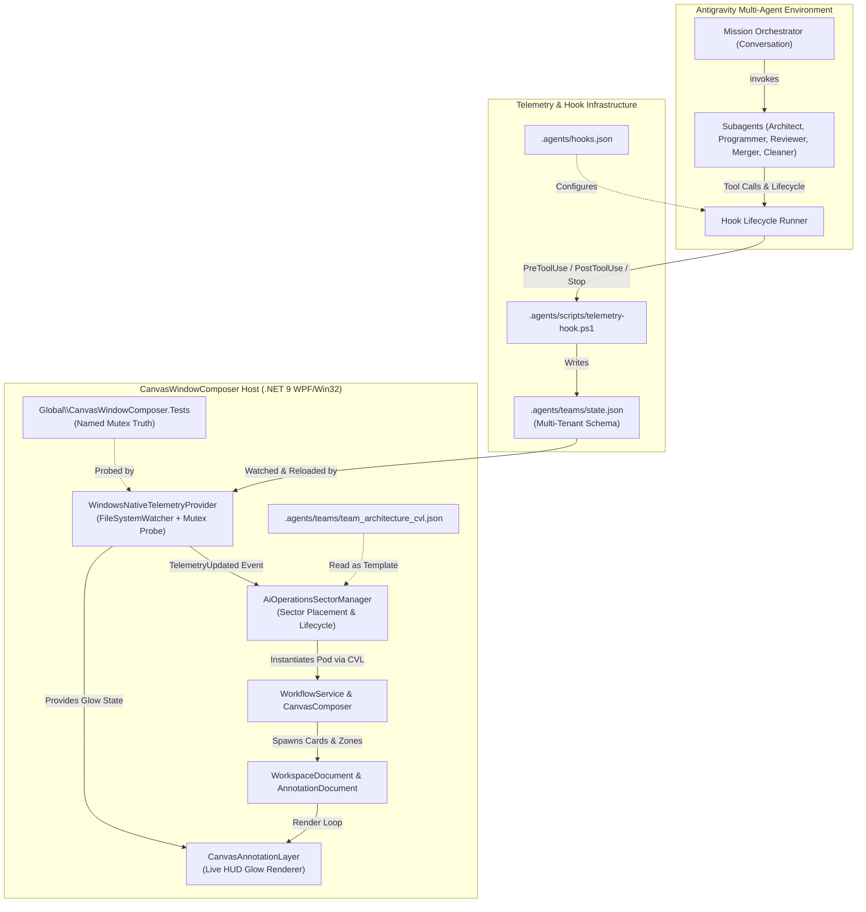

# Architecture Plan: Multi-Tenant Team Telemetry Engine & Dynamic Canvas Pod Spawner

**Target Repository**: `schnepg1/CanvasWindowComposer`  
**Target Branch**: `window_linking_workflows`  
**Architect**: System Architect & Feature Planner Subagent  
**Date**: November 8, 2026  
**Status**: APPROVED / READY FOR IMPLEMENTATION (`PLAN_READY`)

---

## 1. Executive Summary & Scope

CanvasWindowComposer is expanding its agentic orchestration architecture to support **concurrent multi-agent engineering teams** running in isolated worktrees (`..\CanvasWindowComposer-<task>`). 

This architecture plan delivers four cohesive capabilities:
1. **Antigravity Lifecycle Hook Registration**: Authoring `.agents/hooks.json` to integrate `.agents/scripts/telemetry-hook.ps1` with Antigravity agent lifecycle events (`PreToolUse`, `PostToolUse`, `Stop`) with robust stdout/stdin contract enforcement.
2. **Multi-Tenant Team Telemetry Engine**: Upgrading `.agents/teams/state.json`, `.agents/scripts/telemetry-hook.ps1`, and `Source/Workspace/WindowsNativeTelemetryProvider.cs` to track concurrent teams (`teams: { [taskId]: { name, conversationId, worktree, activeRole, roles: { ... } } }`) with seamless backward compatibility for legacy flat `roles`.
3. **Dynamic Canvas Pod Spawning Component**: Establishing a dedicated **AI Operations Sector** on the Canvas workspace, dynamically instantiating visual team workflow pods from `team_architecture_cvl.json` upon team registration, binding live telemetry HUD glows to spawned cards, and safely collapsing/cleaning up pods when teams finish.
4. **Testing & Invariant Verification Strategy**: Comprehensive in-memory and serialized desktop test suites in `Tests/TelemetryTests.cs` and `Tests/VisualizationLanguageTests.cs`, preserving machine-wide named mutex (`Global\CanvasWindowComposer.Tests`) isolation and WPF UI dispatcher invariants.

---

## 2. System Architecture & Data Flow



---

## 3. Component & File Impact Analysis

| Component | Target File | Impact Type | Purpose |
| :--- | :--- | :--- | :--- |
| **Hook Registration** | `.agents/hooks.json` | **Create** | Registers `PreToolUse`, `PostToolUse`, and `Stop` hooks with Antigravity runner. |
| **Telemetry Hook** | `.agents/scripts/telemetry-hook.ps1` | **Modify** | Upgrades stdin parsing, multi-tenant team tracking by `conversationId`, tool matching, and stdout JSON protocol. |
| **Telemetry State** | `.agents/teams/state.json` | **Modify / Schema** | Multi-tenant schema supporting concurrent `teams` while projecting active/legacy `roles`. |
| **Telemetry Contract** | `Modules/CanvasView/TeamTelemetry.cs` | **Modify** | Adds `TeamInstanceTelemetry` record, extends `TeamTelemetrySnapshot`, adds multi-tenant provider APIs. |
| **Native Telemetry** | `Source/Workspace/WindowsNativeTelemetryProvider.cs` | **Modify** | Parses multi-tenant `teams`, tracks active tasks, implements scoped `GetStateForCard` and `GetStateForAnnotation`. |
| **AI Pod Spawner** | `Source/Workspace/AiOperationsSectorManager.cs` | **Create** | Dedicated manager for allocating AI Operations sector, spawning pods from CVL, and pruning on completion. |
| **Overview Controller** | `Source/Overlays/Overview/OverviewManager.Annotations.cs` | **Modify** | Wires `AiOperationsSectorManager` to `ITeamTelemetryProvider.TelemetryUpdated` and UI dispatcher. |
| **Annotation HUD** | `Source/Overlays/Overview/CanvasAnnotationLayer.cs` | **Modify** | Accepts annotation-aware telemetry lookup to drive multi-tenant card glow colors. |
| **Telemetry Tests** | `Tests/TelemetryTests.cs` | **Modify** | Adds test coverage for concurrent teams, mutex probing, and backward compatibility. |
| **Visualization Tests** | `Tests/VisualizationLanguageTests.cs` | **Modify** | Adds tests for AI Operations sector layout, CVL specialization, card telemetry binding, and pod pruning. |

---

## 4. Detailed Component Specifications

### 4.1 Antigravity Hook Registration (`.agents/hooks.json`)

#### File Path: `.agents/hooks.json`
Antigravity discovers hooks placed at `.agents/hooks.json`. The runner executes shell commands using `cmd /c` on Windows with the working directory set to the directory containing `hooks.json` (`.agents/`).

```json
{
  "canvas-team-telemetry": {
    "enabled": true,
    "PreToolUse": [
      {
        "matcher": ".*",
        "hooks": [
          {
            "type": "command",
            "command": "powershell -NoProfile -ExecutionPolicy Bypass -Command \"$s = Resolve-Path 'scripts/telemetry-hook.ps1', '.agents/scripts/telemetry-hook.ps1' -ErrorAction SilentlyContinue | Select-Object -First 1 -ExpandProperty Path; & $s -Event PreToolUse\"",
            "timeout": 15
          }
        ]
      }
    ],
    "PostToolUse": [
      {
        "matcher": ".*",
        "hooks": [
          {
            "type": "command",
            "command": "powershell -NoProfile -ExecutionPolicy Bypass -Command \"$s = Resolve-Path 'scripts/telemetry-hook.ps1', '.agents/scripts/telemetry-hook.ps1' -ErrorAction SilentlyContinue | Select-Object -First 1 -ExpandProperty Path; & $s -Event PostToolUse\"",
            "timeout": 15
          }
        ]
      }
    ],
    "Stop": [
      {
        "type": "command",
        "command": "powershell -NoProfile -ExecutionPolicy Bypass -Command \"$s = Resolve-Path 'scripts/telemetry-hook.ps1', '.agents/scripts/telemetry-hook.ps1' -ErrorAction SilentlyContinue | Select-Object -First 1 -ExpandProperty Path; & $s -Event Stop\"",
        "timeout": 15
      }
    ]
  }
}
```

#### Protocol Requirements:
1. **PreToolUse Contract**:
   - Stdin provides:
     ```json
     {
       "toolCall": { "name": "run_command", "args": { "CommandLine": "..." } },
       "stepIdx": 12,
       "conversationId": "8544f011-fb5e-4059-95be-8cc2b51a3da8"
     }
     ```
   - Stdout **must** output: `{"decision": "allow"}`. Any missing decision or `{}` would trigger interactive user confirmation prompts.
2. **PostToolUse Contract**:
   - Stdout **must** output: `{}`.
3. **Stop Contract**:
   - Stdout **must** output: `{}`.

---

### 4.2 Multi-Tenant Team Telemetry Engine

#### 4.2.1 State Schema (`.agents/teams/state.json`)
The schema supports concurrent teams running in parallel while providing a legacy `roles` projection so that older tools and single-team inspectors remain fully functional:

```json
{
  "updatedAt": "2026-11-08T19:10:00.0000000Z",
  "activeTaskId": "window_linking_workflows",
  "roles": {
    "orchestrator": { "state": "Working", "detail": "Coordinating sprint", "timestamp": "2026-11-08T19:10:00Z" },
    "architect": { "state": "Done", "detail": "Spec created", "timestamp": "2026-11-08T19:05:00Z" },
    "programmer": { "state": "Working", "detail": "Writing code", "timestamp": "2026-11-08T19:10:00Z" },
    "reviewer": { "state": "Idle", "detail": "Awaiting diff", "timestamp": "2026-11-08T19:00:00Z" },
    "merger": { "state": "Idle", "detail": "Awaiting review", "timestamp": "2026-11-08T19:00:00Z" },
    "conflict-resolver": { "state": "Idle", "detail": "", "timestamp": "2026-11-08T19:00:00Z" },
    "branch-cleaner": { "state": "Idle", "detail": "", "timestamp": "2026-11-08T19:00:00Z" }
  },
  "teams": {
    "window_linking_workflows": {
      "name": "Window Linking Feature Team",
      "conversationId": "8544f011-fb5e-4059-95be-8cc2b51a3da8",
      "worktree": "C:\\Users\\ESCEHA\\.gemini\\antigravity\\worktrees\\CanvasWindowComposer\\CanvasWindowComposer-window_linking",
      "activeRole": "programmer",
      "status": "Active",
      "updatedAt": "2026-11-08T19:10:00.0000000Z",
      "roles": {
        "orchestrator": { "state": "Working", "detail": "Coordinating sprint", "timestamp": "2026-11-08T19:10:00Z" },
        "architect": { "state": "Done", "detail": "Spec created", "timestamp": "2026-11-08T19:05:00Z" },
        "programmer": { "state": "Working", "detail": "Writing code", "timestamp": "2026-11-08T19:10:00Z" },
        "reviewer": { "state": "Idle", "detail": "Awaiting diff", "timestamp": "2026-11-08T19:00:00Z" },
        "merger": { "state": "Idle", "detail": "Awaiting review", "timestamp": "2026-11-08T19:00:00Z" },
        "conflict-resolver": { "state": "Idle", "detail": "", "timestamp": "2026-11-08T19:00:00Z" },
        "branch-cleaner": { "state": "Idle", "detail": "", "timestamp": "2026-11-08T19:00:00Z" }
      }
    }
  }
}
```

#### 4.2.2 Upgraded PowerShell Hook (`.agents/scripts/telemetry-hook.ps1`)
The hook reads the Antigravity stdin JSON payload, matches the team by `conversationId`, evaluates tool calls, updates team state, and mirrors to `roles`:

```powershell
param(
    [string]$Event = "PreToolUse"
)

$inputJson = ""
if ([Console]::IsInputRedirected) {
    $inputJson = [Console]::In.ReadToEnd()
}

$repoRoot = Split-Path -Parent (Split-Path -Parent $MyInvocation.MyCommand.Path)
$stateFile = Join-Path $repoRoot ".agents\teams\state.json"

try {
    $state = @{
        updatedAt = [DateTimeOffset]::UtcNow.ToString("o")
        activeTaskId = "default"
        roles = @{}
        teams = @{}
    }

    if (Test-Path $stateFile) {
        $existing = Get-Content -Raw $stateFile | ConvertFrom-Json
        if ($existing.updatedAt) { $state.updatedAt = $existing.updatedAt }
        if ($existing.activeTaskId) { $state.activeTaskId = $existing.activeTaskId }
        if ($existing.roles) {
            foreach ($prop in $existing.roles.PSObject.Properties) {
                $state.roles[$prop.Name] = @{
                    state = $prop.Value.state
                    detail = $prop.Value.detail
                    timestamp = $prop.Value.timestamp
                }
            }
        }
        if ($existing.teams) {
            foreach ($tProp in $existing.teams.PSObject.Properties) {
                $tObj = $tProp.Value
                $teamRoles = @{}
                if ($tObj.roles) {
                    foreach ($rProp in $tObj.roles.PSObject.Properties) {
                        $teamRoles[$rProp.Name] = @{
                            state = $rProp.Value.state
                            detail = $rProp.Value.detail
                            timestamp = $rProp.Value.timestamp
                        }
                    }
                }
                $state.teams[$tProp.Name] = @{
                    name = $tObj.name
                    conversationId = $tObj.conversationId
                    worktree = $tObj.worktree
                    activeRole = $tObj.activeRole
                    status = if ($tObj.status) { $tObj.status } else { "Active" }
                    updatedAt = $tObj.updatedAt
                    roles = $teamRoles
                }
            }
        }
    }

    $toolName = ""
    $command = ""
    $convId = ""
    $targetPath = ""

    if ($inputJson) {
        try {
            $parsed = $inputJson | ConvertFrom-Json
            if ($parsed.conversationId) { $convId = $parsed.conversationId }
            if ($parsed.toolCall) {
                if ($parsed.toolCall.name) { $toolName = $parsed.toolCall.name }
                if ($parsed.toolCall.args) {
                    if ($parsed.toolCall.args.CommandLine) { $command = $parsed.toolCall.args.CommandLine }
                    if ($parsed.toolCall.args.Path) { $targetPath = $parsed.toolCall.args.Path }
                }
            } elseif ($parsed.toolName) {
                $toolName = $parsed.toolName
                if ($parsed.toolArguments -and $parsed.toolArguments.CommandLine) {
                    $command = $parsed.toolArguments.CommandLine
                }
            }
        } catch {}
    }

    # Match or determine target team
    $targetTaskId = $state.activeTaskId
    if ($convId) {
        foreach ($tKey in $state.teams.Keys) {
            if ($state.teams[$tKey].conversationId -eq $convId) {
                $targetTaskId = $tKey
                break
            }
        }
    }

    # Ensure target team entry exists
    if (-not $state.teams.ContainsKey($targetTaskId)) {
        $state.teams[$targetTaskId] = @{
            name = "Team $targetTaskId"
            conversationId = $convId
            worktree = ""
            activeRole = "orchestrator"
            status = "Active"
            updatedAt = [DateTimeOffset]::UtcNow.ToString("o")
            roles = @{}
        }
    }

    $targetTeam = $state.teams[$targetTaskId]

    function Set-TeamRoleState([string]$role, [string]$rState, [string]$rDetail) {
        $now = [DateTimeOffset]::UtcNow.ToString("o")
        $targetTeam.roles[$role] = @{ state = $rState; detail = $rDetail; timestamp = $now }
        $targetTeam.activeRole = $role
        $targetTeam.updatedAt = $now
        $state.roles[$role] = @{ state = $rState; detail = $rDetail; timestamp = $now }
    }

    if ($Event -eq "PreToolUse") {
        if ($toolName -eq "run_command") {
            if ($command -match "Run-Tests|dotnet test") {
                Set-TeamRoleState "programmer" "Testing" "Running test suite under mutex"
                Set-TeamRoleState "reviewer" "Testing" "Validating test results"
            } elseif ($command -match "git merge") {
                Set-TeamRoleState "merger" "Working" "Executing branch merge"
            } elseif ($command -match "git worktree remove") {
                Set-TeamRoleState "branch-cleaner" "Working" "Pruning worktree"
            } elseif ($command -match "git checkout|git worktree add") {
                Set-TeamRoleState "programmer" "Working" "Configuring isolated worktree"
            } else {
                Set-TeamRoleState "programmer" "Working" "Executing command: $command"
            }
        } elseif ($toolName -match "edit_file|write_file") {
            if ($targetPath -match "ARCHITECTURE_PLAN") {
                Set-TeamRoleState "architect" "Working" "Authoring architecture plan"
            } else {
                Set-TeamRoleState "programmer" "Working" "Modifying source code"
            }
        } elseif ($toolName -match "read_file|search_files|search_web") {
            if ($targetTeam.activeRole -eq "reviewer") {
                Set-TeamRoleState "reviewer" "Working" "Reviewing code changes"
            } else {
                Set-TeamRoleState "architect" "Working" "Investigating codebase architecture"
            }
        }
    } elseif ($Event -eq "Stop") {
        foreach ($k in @($targetTeam.roles.Keys)) {
            if ($targetTeam.roles[$k].state -eq "Working" -or $targetTeam.roles[$k].state -eq "Testing") {
                $targetTeam.roles[$k].state = "Done"
                $targetTeam.roles[$k].detail = "Phase finished"
            }
        }
        if ($targetTeam.roles.ContainsKey("branch-cleaner") -and $targetTeam.roles["branch-cleaner"].state -eq "Done") {
            $targetTeam.status = "Completed"
        }
        foreach ($k in @($state.roles.Keys)) {
            if ($state.roles[$k].state -eq "Working" -or $state.roles[$k].state -eq "Testing") {
                $state.roles[$k].state = "Done"
                $state.roles[$k].detail = "Phase finished"
            }
        }
    }

    $state.updatedAt = [DateTimeOffset]::UtcNow.ToString("o")
    $stateDir = Split-Path -Parent $stateFile
    if (-not (Test-Path $stateDir)) { New-Item -ItemType Directory -Path $stateDir -Force | Out-Null }
    $state | ConvertTo-Json -Depth 6 | Set-Content -Path $stateFile -Encoding utf8
} catch {}

if ($Event -eq "PreToolUse") {
    [Console]::Out.Write('{"decision":"allow"}')
} else {
    [Console]::Out.Write('{}')
}
```

#### 4.2.3 Upgraded C# Contracts (`Modules/CanvasView/TeamTelemetry.cs`)
```csharp
namespace CanvasDesktop.CanvasView;

public enum AgentExecutionState
{
    Idle,
    Working,    // Thinking, coding, planning (Cyan glow #38BDF8)
    Testing,    // Running tests under mutex (Amber glow #F59E0B)
    Blocked,    // Waiting for peer review or user confirmation (Orange glow #FB923C)
    Done,       // Task completed successfully (Emerald green glow #10B981)
    Error       // Failed or merge conflict (Red glow #EF4444)
}

public sealed record AgentStatusReport(
    string Role,
    AgentExecutionState State,
    string Detail = "",
    DateTimeOffset Timestamp = default,
    string TaskId = "",
    string Worktree = "");

public sealed record TeamInstanceTelemetry(
    string TaskId,
    string Name,
    string ConversationId,
    string Worktree,
    string ActiveRole,
    string Status, // "Active" | "Completed" | "Failed"
    IReadOnlyDictionary<string, AgentStatusReport> Roles,
    DateTimeOffset UpdatedAt);

public sealed record TeamTelemetrySnapshot(
    IReadOnlyDictionary<string, AgentStatusReport> Roles,
    DateTimeOffset UpdatedAt,
    IReadOnlyDictionary<string, TeamInstanceTelemetry>? Teams = null,
    string? ActiveTaskId = null)
{
    public static TeamTelemetrySnapshot Empty => new(
        new Dictionary<string, AgentStatusReport>(),
        DateTimeOffset.UtcNow,
        new Dictionary<string, TeamInstanceTelemetry>());
}

public interface ITeamTelemetryProvider : IDisposable
{
    TeamTelemetrySnapshot Current { get; }
    event Action<TeamTelemetrySnapshot>? TelemetryUpdated;
    AgentExecutionState GetStateForCard(string cardText);
    AgentExecutionState GetStateForCard(string cardText, string? taskId);
    AgentExecutionState GetStateForAnnotation(CanvasAnnotation item);
    void SetState(string role, AgentExecutionState state, string detail = "");
    void SetTeamState(string taskId, string role, AgentExecutionState state, string detail = "");
    void RegisterTeam(string taskId, string name, string conversationId = "", string worktree = "");
    void CompleteTeam(string taskId, bool success = true);
    void UnregisterTeam(string taskId);
}
```

#### 4.2.4 Upgraded Implementation (`Source/Workspace/WindowsNativeTelemetryProvider.cs`)
- **JSON Deserialization**: Parses root `teams` map. If present, converts each entry into `TeamInstanceTelemetry`. Parses `roles` map for legacy fallback.
- **Hardware Mutex Probe**:
  ```csharp
  if (mutexActive)
  {
      // If hardware mutex is held, all active teams' programmer and reviewer transition to Testing
      foreach (var (tId, team) in teams)
      {
          if (team.Status == "Active")
          {
              // Update programmer & reviewer to Testing
          }
      }
  }
  ```
- **Scoped Card Lookup**:
  - `GetStateForAnnotation(CanvasAnnotation item)`: Checks if the annotation has a team tag in `item.Text` (e.g. `[taskId]`), matches the team's role, and returns that specific team's execution state.

---

### 4.3 Dynamic Canvas Pod Spawning Component

#### 4.3.1 Spatial Architecture & The "AI Operations" Sector
The Canvas coordinate space allows arbitrary floating 2D layouts. User windows typically occupy coordinates near `(0, 0)` to `(4000, 3000)`.

```
================================== CANVAS SPACE ==================================
                                                                                 
 [User Workspaces & Zones]         ┌──────────── AI OPERATIONS SECTOR ────────────┐
  X: [0 .. 5000]                   │ Sector Origin: (X: 8000, Y: 1000)            │
  Y: [0 .. 4000]                   │                                              │
                                   │  ┌──────── Team Pod 1: (task-alpha) ──────┐  │
                                   │  │ [z_command] [z_engineering] [z_release]│  │
                                   │  │  (orch)->(arch)->(dev)->(rev)->(mrg)   │  │
                                   │  └────────────────────────────────────────┘  │
                                   │                   ▲                          │
                                   │                   │ Vertical clearance: 400px│
                                   │                   ▼                          │
                                   │  ┌──────── Team Pod 2: (task-beta) ───────┐  │
                                   │  │ [z_command] [z_engineering] [z_release]│  │
                                   │  │  (orch)->(arch)->(dev)->(rev)->(mrg)   │  │
                                   │  └────────────────────────────────────────┘  │
                                   └──────────────────────────────────────────────┘
```

- **Sector Origin**: `(X: 8000, Y: 1000)` (or dynamic: `Max(ExistingZone.Right) + 1600`).
- **Pod Footprint**: Width ~3400px, Height ~1200px.
- **Inter-Pod Vertical Spacing**: 400px (`dy = 1600px` per stacked lane).
- **Enclosing Sector Master Zone**: `WorkspaceZone` titled `"Spaceship Bridge: AI Operations"` with color `#8B5CF6`.

#### 4.3.2 Component: `Source/Workspace/AiOperationsSectorManager.cs`
Responsible for lifecycle orchestration:
```csharp
namespace CanvasDesktop;

internal sealed class AiOperationsSectorManager
{
    private readonly WorkspaceService _workspace;
    private readonly AnnotationDocument _annotations;
    private readonly AnnotationPersistence? _annotationStore;
    private readonly ITeamTelemetryProvider _telemetry;
    private readonly CanvasPoint _sectorOrigin = new(8000, 1000);
    private const double PodHeight = 1200;
    private const double PodSpacing = 400;

    private readonly Dictionary<string, SpawnedPod> _spawnedPods = new(StringComparer.OrdinalIgnoreCase);

    public sealed record SpawnedPod(
        string TaskId,
        CanvasPoint Origin,
        IReadOnlyList<Guid> ZoneIds,
        IReadOnlyList<Guid> AnnotationIds,
        IReadOnlyDictionary<Guid, string> CardRoleMap);

    public AiOperationsSectorManager(
        WorkspaceService workspace,
        AnnotationDocument annotations,
        AnnotationPersistence? annotationStore,
        ITeamTelemetryProvider telemetry)
    {
        _workspace = workspace;
        _annotations = annotations;
        _annotationStore = annotationStore;
        _telemetry = telemetry;
    }

    public bool HasPod(string taskId) => _spawnedPods.ContainsKey(taskId);

    public SpawnedPod? SpawnPod(Guid desktopId, TeamInstanceTelemetry team, string cvlTemplateJson)
    {
        if (_spawnedPods.ContainsKey(team.TaskId)) return _spawnedPods[team.TaskId];

        int slotIndex = _spawnedPods.Count;
        var podOrigin = new CanvasPoint(_sectorOrigin.X, _sectorOrigin.Y + slotIndex * (PodHeight + PodSpacing));

        var basePlan = JsonSerializer.Deserialize<ComposerPlan>(cvlTemplateJson, new JsonSerializerOptions { PropertyNameCaseInsensitive = true });
        if (basePlan == null) return null;

        // Specialize Plan for Task
        string prefix = $"pod_{team.TaskId}_";
        var specializedNodes = basePlan.Nodes.Select(n => n with
        {
            Id = prefix + n.Id,
            Title = $"[{team.TaskId}] {n.Title}",
            Subtitle = !string.IsNullOrEmpty(team.Worktree) ? $"Worktree: {Path.GetFileName(team.Worktree)}" : n.Subtitle,
            Text = $"[{team.TaskId}] {n.Title}\n{(string.IsNullOrEmpty(team.Worktree) ? n.Subtitle : Path.GetFileName(team.Worktree))}",
            Zone = prefix + n.Zone
        }).ToArray();

        var specializedZones = basePlan.Zones?.Select(z => z with
        {
            Id = prefix + z.Id,
            Name = $"[{team.TaskId}] {z.Name}"
        }).ToArray();

        var specializedEdges = basePlan.Edges.Select(e => e with
        {
            From = prefix + e.From,
            To = prefix + e.To
        }).ToArray();

        var specializedPlan = basePlan with
        {
            Summary = $"Team Pod: {team.Name} ({team.TaskId})",
            Nodes = specializedNodes,
            Zones = specializedZones,
            Edges = specializedEdges
        };

        var context = new ComposerContext(desktopId, _annotations.Revision, podOrigin, [], []);
        var preview = CanvasComposer.Prepare(context, specializedPlan);

        var workflowService = new WorkflowService(_workspace, _annotations, _annotationStore);
        bool applied = workflowService.ApplyComposerPlan(desktopId, specializedPlan, preview);
        if (!applied) return null;

        var cardRoleMap = new Dictionary<Guid, string>();
        var spawnedAnnotIds = preview.Items.Select(i => i.Id).ToList();
        var spawnedZoneIds = specializedZones?.Select(z => _workspace.Document.Zones.FirstOrDefault(wz => wz.Name == z.Name)?.Id ?? Guid.Empty)
            .Where(g => g != Guid.Empty).ToList() ?? new List<Guid>();

        foreach (var node in basePlan.Nodes)
        {
            string specializedId = prefix + node.Id;
            if (preview.NodeIdMap != null && preview.NodeIdMap.TryGetValue(specializedId, out var annotId))
            {
                cardRoleMap[annotId] = node.Id; // e.g. "dev", "arch", "rev", "mrg", "cln"
            }
        }

        var spawned = new SpawnedPod(team.TaskId, podOrigin, spawnedZoneIds, spawnedAnnotIds, cardRoleMap);
        _spawnedPods[team.TaskId] = spawned;
        return spawned;
    }

    public bool CleanPod(Guid desktopId, string taskId)
    {
        if (!_spawnedPods.TryGetValue(taskId, out var pod)) return false;

        // 1. Remove all annotations
        foreach (var annotId in pod.AnnotationIds)
        {
            _annotations.Remove(annotId);
        }

        // 2. Remove all workspace zones
        foreach (var zoneId in pod.ZoneIds)
        {
            var zone = _workspace.Document.Zones.FirstOrDefault(z => z.Id == zoneId);
            if (zone != null) _workspace.Document.Zones.Remove(zone);
        }

        _workspace.SaveNow();
        _annotationStore?.Save();
        _spawnedPods.Remove(taskId);
        return true;
    }
}
```

#### 4.3.3 Integration in `OverviewManager.Annotations.cs`
- In `AttachAnnotations()`:
  ```csharp
  _sectorManager = new AiOperationsSectorManager(_placeholderWorkspace, _annotationDocument, _annotationStore, _telemetryProvider);
  _telemetryProvider.TelemetryUpdated += snapshot =>
  {
      if (_disposed) return;
      if (_passes.Count > 0 && _passes[0].IsHandleCreated)
      {
          _passes[0].BeginInvoke(() =>
          {
              if (_disposed) return;
              ReconcileTeamPods(snapshot);
              ReconcileVisuals();
          });
      }
  };
  ```
- In `ReconcileTeamPods(TeamTelemetrySnapshot snapshot)`:
  - Iterates `snapshot.Teams.Values`:
    - If `team.Status == "Active"` and `!_sectorManager.HasPod(team.TaskId)`:
      - Read cached `team_architecture_cvl.json` and call `_sectorManager.SpawnPod(desktop, team, cvlJson)`.
      - Call `RefreshZoneLayout()`.
    - If `team.Status == "Completed"` or `team.Roles["branch-cleaner"].State == AgentExecutionState.Done`:
      - Call `_sectorManager.CleanPod(desktop, team.TaskId)`.
      - Call `RefreshZoneLayout()`.

#### 4.3.4 Visual HUD Glow Binding in `CanvasAnnotationLayer.cs`
In `CanvasAnnotationLayer.cs`, the render pass computes `telemetryState?.Invoke(item)`.
With the multi-tenant upgrade:
```csharp
// In OverviewManager.Annotations.cs:
_annotationLayer = new CanvasAnnotationLayer(
    _annotationDocument,
    _annotationTool,
    _annotationDesktop,
    () => CurrentMode == OverviewMode.Zooming && !IsStartupIntroActive,
    id => _composerPreviewIds.Contains(id) || _annotationEditor?.CurrentItem.Id == id,
    () => _windows.Windows.Where(w => !w.ScreenFixed).Select(w => new CanvasRect(w.World.X, w.World.Y, w.World.W, w.World.H)).ToArray(),
    () => _connectionTool?.Preview,
    item => _telemetryProvider?.GetStateForAnnotation(item));
```
When `_telemetryProvider.GetStateForAnnotation(item)` evaluates `item`:
- It extracts the `[taskId]` prefix from `item.Text` (e.g. `[window_linking] Worktree Programmer`).
- Looks up the team instance in `Current.Teams[taskId]`.
- Determines the role (`"programmer"`) and returns that team's exact execution state (e.g. `AgentExecutionState.Working` -> Cyan glow #38BDF8).
- Unrelated cards without team tags fall back to `GetStateForCard(item.Text)`.

---

## 5. Atomic Implementation Checklist

The implementation must be executed in the following sequential order:

- [ ] **Task 1: Author Antigravity Hook Registration (`.agents/hooks.json`)**
  - Create `.agents/hooks.json` specifying `canvas-team-telemetry` hook.
  - Configure `PreToolUse` (matcher: `".*"`), `PostToolUse` (matcher: `".*"`), and `Stop` event handlers calling `.agents/scripts/telemetry-hook.ps1`.
  - Enforce resilience by resolving path with fallback between `scripts/` and `.agents/scripts/`.

- [ ] **Task 2: Upgrade PowerShell Telemetry Hook (`.agents/scripts/telemetry-hook.ps1`)**
  - Upgrade stdin payload parser to handle `parsed.conversationId`, `parsed.toolCall.name`, and `parsed.toolCall.args.CommandLine`.
  - Implement multi-tenant team matching via `conversationId` into `$state.teams`.
  - Implement role transition triggers (`Run-Tests|dotnet test` -> `Testing`, `git merge` -> `Working`, `git worktree remove` -> `branch-cleaner`, etc.).
  - Mirror active team's status into root `$state.roles` for backward compatibility.
  - Enforce stdout JSON protocol: `{"decision": "allow"}` for `PreToolUse` and `{}` for `PostToolUse` and `Stop`.

- [ ] **Task 3: Upgrade Telemetry Contracts (`Modules/CanvasView/TeamTelemetry.cs`)**
  - Add `TeamInstanceTelemetry` record with `TaskId`, `Name`, `ConversationId`, `Worktree`, `ActiveRole`, `Status`, `Roles`, `UpdatedAt`.
  - Extend `TeamTelemetrySnapshot` with optional `IReadOnlyDictionary<string, TeamInstanceTelemetry>? Teams` and `string? ActiveTaskId` (preserving binary constructor compatibility).
  - Add `GetStateForCard(string cardText, string? taskId)` and `GetStateForAnnotation(CanvasAnnotation item)` to `ITeamTelemetryProvider`.
  - Add `SetTeamState`, `RegisterTeam`, `CompleteTeam`, and `UnregisterTeam` to `ITeamTelemetryProvider`.

- [ ] **Task 4: Implement Multi-Tenant Provider (`Source/Workspace/WindowsNativeTelemetryProvider.cs`)**
  - In `ReloadState()`: deserialize `teams` object if present; fall back to legacy `roles`.
  - In `CheckHardwareAndState()`: when hardware named mutex is acquired, update `programmer` and `reviewer` to `Testing` across all active teams and root `Roles`.
  - Implement `GetStateForAnnotation(CanvasAnnotation item)` with regex/prefix extraction for `[taskId]`.
  - Implement `SetTeamState(taskId, role, state, detail)` updating both `$teams[taskId]` and root `Roles`.

- [ ] **Task 5: Implement `AiOperationsSectorManager` (`Source/Workspace/AiOperationsSectorManager.cs`)**
  - Create class with dedicated `_sectorOrigin = new CanvasPoint(8000, 1000)`.
  - Implement `SpawnPod(Guid desktopId, TeamInstanceTelemetry team, string cvlJson)`:
    - Specializes node IDs, titles, subtitles, and zone IDs with `team.TaskId`.
    - Generates preview via `CanvasComposer.Prepare`.
    - Materializes nodes and zones via `WorkflowService.ApplyComposerPlan`.
    - Retains tracking in `_spawnedPods`.
  - Implement `CleanPod(Guid desktopId, string taskId)`:
    - Removes all associated annotations and workspace zones.
    - Flushes changes via `_workspace.SaveNow()` and `_annotationStore.Save()`.

- [ ] **Task 6: Wire Sector Manager in `OverviewManager.Annotations.cs`**
  - Instantiate `AiOperationsSectorManager` during `AttachAnnotations`.
  - Subscribe to `_telemetryProvider.TelemetryUpdated` and marshal to UI thread via `_passes[0].BeginInvoke(...)`.
  - Trigger `SpawnPod` when new active teams appear; trigger `CleanPod` when team status becomes `Completed` or `branch-cleaner` reports `Done`.
  - Update `CanvasAnnotationLayer` initialization to use `_telemetryProvider.GetStateForAnnotation(item)`.

- [ ] **Task 7: Author Unit & Integration Tests in `Tests/TelemetryTests.cs`**
  - `Provider_LoadsMultiTenantTeamsJsonState`: Verifies parsing concurrent teams, active roles, and backward-compatible root roles.
  - `Provider_SetTeamState_PersistsAndSyncsRootRoles`: Verifies updating a specific team persists to disk and mirrors to root roles.
  - `Provider_GetStateForCard_ScopedToTeam`: Verifies card text matching with explicit `taskId` and embedded `[taskId]` tags.
  - `Provider_HardwareMutex_OverridesActiveTeamProgrammerAndReviewer`: Verifies that simulated mutex hold transitions active team roles to `Testing`.
  - `Provider_RegistersAndCompletesTeam`: Verifies lifecycle registration and completion transitions.

- [ ] **Task 8: Author Pod Spawner Tests in `Tests/VisualizationLanguageTests.cs`**
  - `AiOperationsSector_AllocatesDedicatedCoordinates`: Verifies sector coordinates are beyond user workspace content.
  - `AiOperationsSector_SpawnTeamPod_MaterializesNodesZonesArrows`: Verifies CVL instantiation for a specific `taskId`, specialized node IDs, zone bounding boxes, and curved arrow connections.
  - `AiOperationsSector_BindsSpawnedCardsToTeamTelemetry`: Verifies spawned cards reflect their team instance's execution state.
  - `AiOperationsSector_CleansUpPod_WhenBranchCleanerDone`: Verifies complete removal of annotations and zones upon team completion.

---

## 6. Test & Verification Strategy

### 6.1 Fast In-Memory Unit Tests (`Category!=Native*`)
All new tests in `Tests/TelemetryTests.cs` and `Tests/VisualizationLanguageTests.cs` run strictly in-memory using `WorkspaceHarness` and `mutexProbe` delegates.
- Run command:
  ```powershell
  powershell -NoProfile -ExecutionPolicy Bypass -File Tools\Run-Tests.ps1 -Configuration Release -Filter "FullyQualifiedName~TelemetryTests|FullyQualifiedName~VisualizationLanguageTests"
  ```
- Invariant check: In-memory tests must never acquire `Global\CanvasWindowComposer.Tests` mutex directly; they supply `mutexProbe: () => isHeld` to test mutex state machines deterministically.

### 6.2 Serialized Integration & Desktop Tests
Before any merge into `window_linking_workflows`:
- Full test suite run via `Tools/Run-Tests.ps1` to verify all existing categories (`NativeRendering`, `NativeParking`, `NativePlacement`, `NativePreview`):
  ```powershell
  Tests\run_tests.bat -Configuration Release
  ```
- Verify zero regressions across workspace composition, window navigation, and zone layouts.

---

## 7. Edge Cases & Risk Analysis

| Risk / Failure Mode | Root Cause | Architectural Mitigation |
| :--- | :--- | :--- |
| **Antigravity Tool Call Blocked** | `PreToolUse` hook output missing `decision: allow` | `telemetry-hook.ps1` explicitly outputs `{"decision":"allow"}` to stdout on all `PreToolUse` events. |
| **Concurrent File Contention on `state.json`** | Simultaneous writes from concurrent subagent hooks | Wrap read/write in `telemetry-hook.ps1` with exponential backoff and retry (3 attempts) on `IOException`. |
| **Orphaned Cards on Crash** | Agent process crashes before `worktree-cleaner` runs | `AiOperationsSectorManager` sweeps `_spawnedPods` against active `state.json` teams; any pod whose team is marked `Completed` or deleted is cleaned up. |
| **WPF Dispatcher Exception** | Telemetry FileSystemWatcher firing on background IO thread | `OverviewManager.Annotations.cs` checks `_passes[0].InvokeRequired` and dispatches via `BeginInvoke` onto the UI thread before mutating annotations or zones. |
| **Named Mutex Contention** | Multiple test runners competing for desktop tests | Serialized via `Global\CanvasWindowComposer.Tests` mutex inside `Tools\Run-Tests.ps1` with a 60-minute wait timeout. |
| **Legacy Tool Breakdown** | Older tools reading top-level `roles` only | `telemetry-hook.ps1` and `WindowsNativeTelemetryProvider` continuously project the active team's roles into root `roles`. |

---

## 8. Handover Summary

```yaml
status: "PLAN_READY"
task_id: "multi_tenant_telemetry_canvas_pod_spawner"
target_branch: "window_linking_workflows"
plan_path: "ARCHITECTURE_PLAN.md"
estimated_tasks: 8
requires_native_tests: false
```