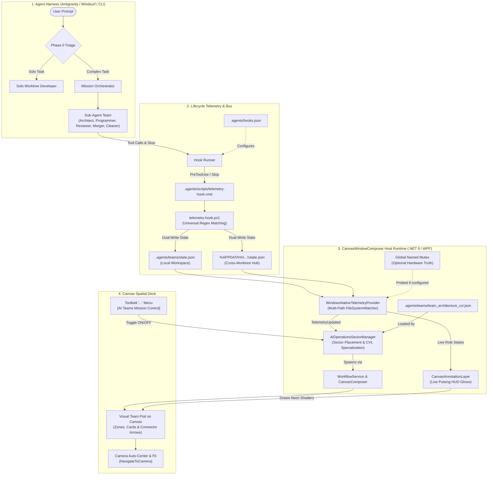
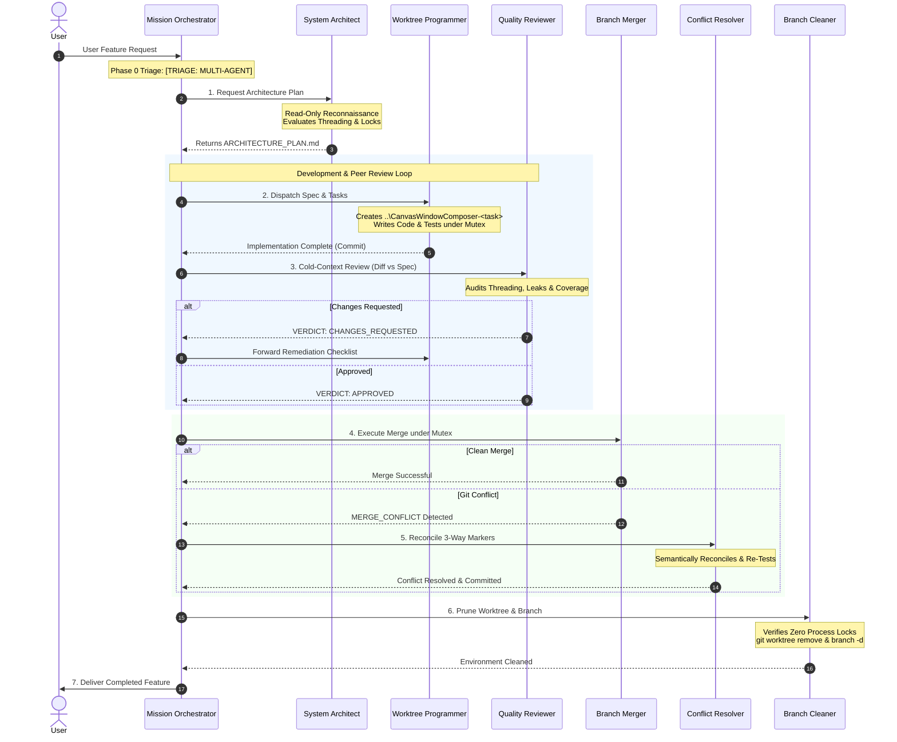

# AI Mission Control: Multi-Agent Spatial Telemetry & Orchestration Engine

> **CanvasWindowComposer as an AI Operating System & Live Mission Deck**  
> *Transforming autonomous coding agents into real-time, visual spatial workflows on your desktop canvas.*

---

## 1. Executive Overview

**AI Mission Control** is a vendor-neutral, multi-agent software engineering rig and real-time visual telemetry engine integrated directly into **CanvasWindowComposer**.

Historically, when autonomous coding agents (such as Google Antigravity, Gemini CLI, Claude Code, Windsurf/Codium, or OpenCode) work on complex features, their internal progress—planning, editing, testing under locks, reviewing diffs, and resolving merge conflicts—remains trapped inside text chat windows and terminal logs.

AI Mission Control bridges this gap by turning your infinite spatial desktop into an **active mission control deck**:

1. **Autonomous Team Orchestration**: Deconstructs complex user requests into specialized agent roles with strict context boundaries and peer review loops.
2. **Invisible Real-Time Telemetry**: Captures tool execution and agent lifecycle transitions in real time without requiring the model to waste tokens or call special status tools.
3. **Dynamic Canvas Materialization**: Spawns visual team workflow pods on the desktop canvas with animated HUD glows representing live agent states (Cyan for Working, Amber for Testing, Emerald Green for Done).
4. **Predictable UI Control**: Provides an instant toggle in the Canvas Toolbelt ("AI Teams Mission Control") that auto-navigates and fits the camera onto the team pod.
5. **Universal & Config-Driven**: Operates completely out of the box across any language or framework (Python, Node.js, Rust, Go, Java, or C#) with zero external package dependencies.

---

## 2. End-to-End System Architecture



---

## 3. The 7-Role Multi-Agent Team Rig

For non-trivial features, the system splits engineering labor across specialized roles defined in [`.agents/skills/`](../.agents/skills/) and [`.agents/teams/teams.yaml`](../.agents/teams/teams.yaml). Each role operates with isolated context to eliminate confirmation bias and context rot:



### Role Catalog

| Role | Skill Directory | Workspace Mode | Core Responsibility |
| :--- | :--- | :--- | :--- |
| **Mission Orchestrator** | *Root Session* | `inherit` | Holds macro state machine; never touches code; routes tasks between agents. |
| **System Architect** | [`.agents/skills/architect-planning`](../.agents/skills/architect-planning) | `inherit` (read-only) | Codebase reconnaissance; authors atomic task blueprints (`ARCHITECTURE_PLAN.md`). |
| **Worktree Programmer** | [`.agents/skills/worktree-developer`](../.agents/skills/worktree-developer) | `isolated-worktree` | Creates isolated branch and worktree; writes production code and unit tests. |
| **Quality Reviewer** | [`.agents/skills/code-reviewer`](../.agents/skills/code-reviewer) | `inherit` (read-only) | Cold-context review of diff vs. plan; audits thread dispatching and resource safety. |
| **Branch Merger** | [`.agents/skills/branch-merger`](../.agents/skills/branch-merger) | `target-checkout` | Verifies reviewer approval; synchronizes branches; merges under test mutex. |
| **Conflict Resolver** | [`.agents/skills/conflict-resolver`](../.agents/skills/conflict-resolver) | `merge-workspace` | Exception handler; semantically reconciles 3-way git conflicts and re-verifies. |
| **Branch Cleaner** | [`.agents/skills/worktree-cleaner`](../.agents/skills/worktree-cleaner) | `inherit` | Audits process locks (`CanvasDesktop`, `dotnet`, `testhost`); prunes worktrees and branches. |

---

## 4. Phase 0: Dynamic Reconnaissance & Triage Protocol

Every agent reading [`AGENTS.md`](../AGENTS.md) must execute Phase 0 before writing code:

1. **Read-Only Codebase Reconnaissance**:
   - Locates symbols, interfaces, and call sites without modifying files.
2. **Dynamic Blast Radius Evaluation**:
   - Spans $> 2–3$ files or multiple subsystem boundaries?
   - Involves native OS handles (Win32 HWND, D3D, DWM, hooks) or WPF `Dispatcher` concurrency?
   - Requires serialized desktop integration tests under machine-wide mutexes?
   - High risk of regression or merge conflict on target branch?
3. **Decision Gate**:
   - **All NO** $\to$ `[TRIAGE: SOLO]` (Execute directly in single worktree).
   - **Any YES** $\to$ `[TRIAGE: MULTI-AGENT]` (Promote to Architect and launch team).

---

## 5. Live Telemetry & Hook Infrastructure

The telemetry subsystem updates the visual canvas in real time with **zero cognitive burden** on the agents.

### A. Lifecycle Hook Protocol (`.agents/hooks.json` & `.cmd`)
Antigravity executes [`.agents/scripts/telemetry-hook.cmd`](../.agents/scripts/telemetry-hook.cmd) via cmd wrapper to eliminate PowerShell inline variable expansion failures:

* **`PreToolUse`**: Fires **before** a tool starts executing. It deduces the active role from the command or file edited, updates `state.json` to `Working` or `Testing`, and returns `{"decision":"allow"}` to stdout.
* **`Stop`**: Fires when an agent finishes its work turn, automatically transitioning active roles to `Done`.

```json
{
  "canvas-team-telemetry": {
    "enabled": true,
    "PreToolUse": [
      {
        "matcher": ".*",
        "hooks": [
          {
            "type": "command",
            "command": "cmd /c scripts\\telemetry-hook.cmd -Event PreToolUse",
            "timeout": 15
          }
        ]
      }
    ],
    "Stop": [
      {
        "type": "command",
        "command": "cmd /c scripts\\telemetry-hook.cmd -Event Stop",
        "timeout": 15
      }
    ]
  }
}
```

### B. Multi-Tenant Telemetry Schema (`state.json`)
The telemetry state supports concurrent teams while remaining backward-compatible with legacy single-team monitors:

```json
{
  "updatedAt": "2026-11-09T00:30:00Z",
  "activeTaskId": "window_linking_42",
  "teams": {
    "window_linking_42": {
      "name": "Feature: Window Linking",
      "taskId": "window_linking_42",
      "activeRole": "programmer",
      "status": "Active",
      "roles": {
        "architect": { "state": "Done", "detail": "Spec approved" },
        "programmer": { "state": "Working", "detail": "Editing WindowManager.cs" },
        "reviewer": { "state": "Idle", "detail": "" }
      }
    }
  },
  "roles": {
    "programmer": { "state": "Working", "detail": "Editing WindowManager.cs" }
  }
}
```

### C. Cross-Worktree Rendezvous Hub
Sub-agents often execute inside separate worktrees (`..\CanvasWindowComposer-<task>`). To ensure the primary host application captures events from external worktrees:
* `telemetry-hook.ps1` writes to both the local repo and `%APPDATA%\CanvasWindowComposer\Teams\state.json`.
* `WindowsNativeTelemetryProvider.cs` sets up multiple `FileSystemWatcher` instances to aggregate local and global AppData updates simultaneously.

---

## 6. Config-Driven & Multi-Language Design

The system is decoupled from WPF/.NET specifics, making it universal for any repository:

### A. Zero-Overhead Hardware Mutex Configuration
In `.agents/teams/teams.yaml`:
```yaml
telemetry:
  # Optional: Named OS mutex for desktop tests (null/omitted disables polling timer completely)
  mutex_name: "Global\\CanvasWindowComposer.Tests"
  # Custom or universal test runner regex
  test_command_pattern: "Run-Tests|dotnet test|pytest|npm test|cargo test|go test|mvn test"
  # Active CVL visualization template
  cvl_template: ".agents/teams/team_architecture_cvl.json"
```
* **Desktop Repos**: Polls the named mutex every 300ms to detect hardware test runs.
* **Web / Python / Rust Repos**: When `mutex_name` is omitted or null, `_pollTimer` is **completely null**, creating **zero background thread wakeups and zero polling overhead**.

### B. Universal Test Runner Detection
`telemetry-hook.ps1` automatically detects test executions across:
* **Python**: `pytest`, `python -m unittest`
* **Node.js**: `npm test`, `yarn test`, `pnpm test`
* **Rust**: `cargo test`
* **Go**: `go test`
* **Java**: `mvn test`, `gradle test`, `gradlew test`
* **.NET**: `dotnet test`, `Run-Tests.ps1`

### C. Zero NuGet Dependencies
Configuration reading is implemented in `TeamTelemetryConfig.cs` using pure BCL regex line parsing. It introduces zero NuGet dependencies and preserves `packages.lock.json` locked-mode compilation in CI.

---

## 7. Canvas Spatial User Interface

### A. The Toolbelt Context Menu Toggle
Users can toggle the AI Operations area directly from the Canvas Toolbelt:
1. Click the **"..." (More actions)** button on the floating toolbelt.
2. Select **"AI Teams Mission Control"** (with compose glyph and checkmark).
3. **Toggled ON**: Instantiates the visual pod and **smoothly centers/fits the camera** to it (`NavigateToCamera`). It remains persistent and will **never** randomly vanish when turns complete.
4. **Toggled OFF**: Cleans all pod annotations and zones from the workspace.

### B. Live HUD Glow Shaders
Cards on the canvas glow dynamically based on real-time execution states:

| State | HUD Glow Color | RGB Hex | Meaning |
| :--- | :--- | :--- | :--- |
| **Working** | Cyan / Sky Blue | `#38BDF8` | Agent is actively planning, writing code, or executing tools. |
| **Testing** | Amber / Orange | `#F59E0B` | Agent is running the test suite or holding the test mutex. |
| **Blocked** | Vivid Orange | `#FB923C` | Agent is paused waiting for peer review or user confirmation. |
| **Done** | Emerald Green | `#10B981` | Phase or task successfully completed. |
| **Error** | Crimson Red | `#EF4444` | Build failure, test failure, or merge conflict. |

---

## 8. Quickstart Guide: Adding Mission Control to Any Project

To enable AI Mission Control in a new project (e.g. `MyNextJsApp` or `FastApiBackend`):

1. **Install CanvasWindowComposer**: Keep the desktop application running.
2. **Copy `.agents/`**: Copy the `.agents/` folder into your project root.
3. **Configure `teams.yaml`**:
   ```yaml
   telemetry:
     mutex_name: null  # No Windows desktop mutex required
     test_command_pattern: "pytest|npm test"
   ```
4. **Run Cross-Tool Symlinks**:
   ```powershell
   powershell -ExecutionPolicy Bypass -File .agents\scripts\setup-agent-links.ps1
   ```
5. **Start Coding**: Launch your preferred agent (Antigravity, Windsurf, Claude Code, Cursor). 
6. **Open Canvas**: In CanvasWindowComposer, click **`...` $\to$ `AI Teams Mission Control`** to watch your AI team collaborate in real time!

---

*Document Author: Antigravity Mission Orchestration Rig*  
*Target Branch: `main`*  
*Repository: `schnepg1/CanvasWindowComposer`*
