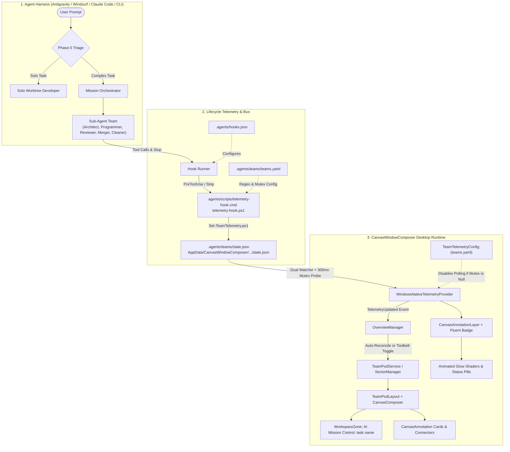
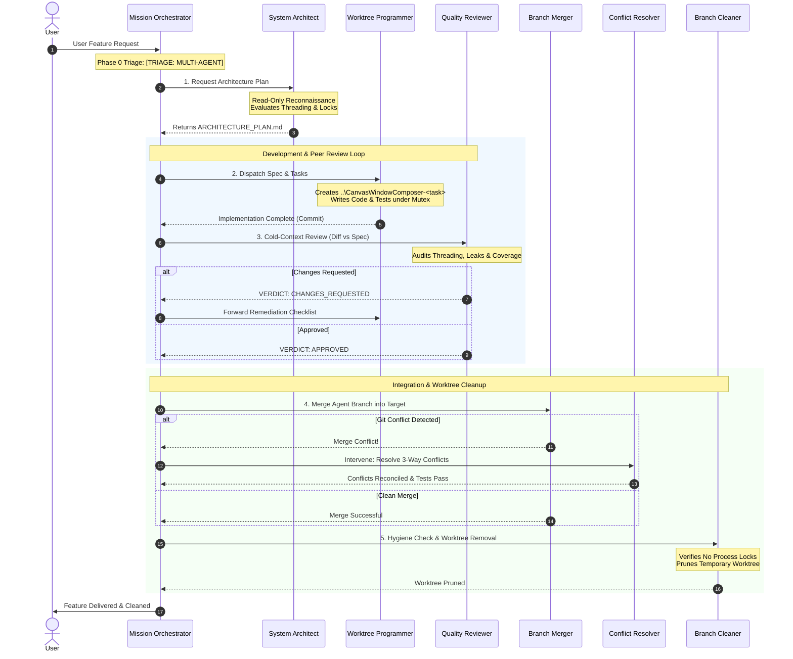

# AI Mission Control: Multi-Agent Spatial Telemetry & Orchestration Engine

> **CanvasWindowComposer as an AI Operating System & Live Mission Deck**  
> *Transforming autonomous coding agents into real-time, visual spatial workflows on your desktop canvas.*

---

## 1. Executive Overview

**AI Mission Control** is a vendor-neutral, multi-agent software engineering rig and real-time visual telemetry engine integrated directly into **CanvasWindowComposer**.

Historically, when autonomous coding agents (such as Google Antigravity, Gemini CLI, Claude Code, Windsurf/Codium, or OpenCode) work on complex features, their internal progress—planning, editing, testing under locks, reviewing diffs, and resolving merge conflicts—remains trapped inside text chat windows and terminal logs.

AI Mission Control bridges this gap by turning your infinite spatial desktop into an **active mission control deck**:

1. **Autonomous Team Orchestration**: Deconstructs complex user requests into specialized agent roles with strict context boundaries, peer review loops, and isolated git worktrees.
2. **Invisible Real-Time Telemetry**: Captures tool execution and agent lifecycle transitions in real time without requiring the model to waste tokens or call special status tools.
3. **Dynamic Canvas Materialization**: Materializes task-specific visual team pods on the desktop canvas with animated HUD glows (Cyan for Working, Amber for Testing, Emerald Green for Done, Orange for Blocked, Red for Error) and Fluent status/detail pills.
4. **Persistent Spatial Control & Grouped Movement**: Lets users find a pod in the project navigator, drag its frame to move all role cards and connectors in one undoable operation, and persist positions across app restarts.
5. **Universal & Config-Driven**: Decoupled from .NET/WPF specifics, operating out of the box across any language or framework (Python, Node.js, Rust, Go, Java, or C#) with zero external NuGet dependencies.

The delivered task-pod implementation was merged in [PR #33](https://github.com/schnepg1/CanvasWindowComposer/pull/33).
For a shorter operational runbook, see [Agent team pods](team-pods.md).
For deep multi-agent coordination theory, topology trade-offs, and the learning module architecture, see [AI Agent Orchestration Theory](ai-agents-orchestration-theory.md).

---

## 2. End-to-End System Architecture



The host targets .NET 10 on Windows and uses WPF-UI. The Canvas runtime consumes external agent telemetry and manages the visual desktop environment.

---

## 3. The 7-Role Multi-Agent Team Rig

For non-trivial features, the system splits engineering labor across specialized roles defined in [`.agents/skills/`](../.agents/skills/) and [`.agents/teams/teams.yaml`](../.agents/teams/teams.yaml). Each role operates with isolated context to eliminate confirmation bias and context rot:



### Role Matrix

| Role | Responsibility | Skill Folder | Safety Constraints |
| :--- | :--- | :--- | :--- |
| **Mission Orchestrator** | Team coordinator, task router, triage gatekeeper | *Entry Agent* | Never modifies code directly. Enforces transitions. |
| **System Architect** | Reconnaissance, technical spec, atomic checklists | [`.agents/skills/architect-planning`](../.agents/skills/architect-planning) | Read-only codebase access. No builds or edits. |
| **Worktree Programmer** | Isolated production code & test implementation | [`.agents/skills/worktree-developer`](../.agents/skills/worktree-developer) | Always executes in `..\CanvasWindowComposer-<task>`. Runs serialized tests. |
| **Quality Reviewer** | Blind diff review vs spec, handles & threading audit | [`.agents/skills/code-reviewer`](../.agents/skills/code-reviewer) | Fresh, unpolluted context. Re-runs tests under named mutex. |
| **Branch Merger** | Verifies approvals, fast-forwards/merges branch | [`.agents/skills/branch-merger`](../.agents/skills/branch-merger) | Re-runs full test suite post-merge. Escalates conflicts. |
| **Conflict Resolver** | Reconciles 3-way conflicts, restores invariants | [`.agents/skills/conflict-resolver`](../.agents/skills/conflict-resolver) | Preserves upstream intent while keeping new feature additions. |
| **Branch Cleaner** | Prunes worktree directory and local branch | [`.agents/skills/worktree-cleaner`](../.agents/skills/worktree-cleaner) | Verifies no `dotnet` or `CanvasDesktop` locks exist before removal. |

---

## 4. Autonomous Telemetry & Lifecycle Hooks

To eliminate token waste and manual status reporting, agent activities are tracked through transparent lifecycle hooks:

### A. The Hook Configuration
Defined in [`.agents/hooks.json`](../.agents/hooks.json):
```json
{
  "hooks": [
    {
      "name": "Canvas Team Telemetry - PreToolUse",
      "event": "PreToolUse",
      "command": "cmd.exe /c \"%~dp0scripts\\telemetry-hook.cmd\" PreToolUse"
    },
    {
      "name": "Canvas Team Telemetry - Stop",
      "event": "Stop",
      "command": "cmd.exe /c \"%~dp0scripts\\telemetry-hook.cmd\" Stop"
    }
  ]
}
```

### B. Hook Protocol & Stream Safety
The Antigravity hook runner communicates with `.agents/scripts/telemetry-hook.cmd` via stdin and stdout.
* **PreToolUse Protocol**: The hook runner expects `{"decision":"allow"}` on stdout. Any syntax error or unexpected text printed to stdout causes hook runner deserialization crashes.
* **Batch Wrapper (`telemetry-hook.cmd`)**: Invokes PowerShell with `-NoProfile -NonInteractive -File` to prevent shell variable expansion of `$s`.
* **Tool Deduction**:
  * Running test commands (`Run-Tests`, `dotnet test`, `pytest`, `npm test`, `cargo test`) $\to$ marks **Programmer** and **Reviewer** as **Testing**.
  * Editing `ARCHITECTURE_PLAN.md` $\to$ marks **Architect** as **Working**.
  * Editing source code $\to$ marks **Programmer** as **Working**.
  * Reading files / reviewing diffs $\to$ marks **Reviewer** as **Working**.
  * Running `git merge` $\to$ marks **Merger** as **Working**.
  * Running `git worktree remove` $\to$ marks **Cleaner** as **Working**.
  * Agent finishes invocation (`Stop` event) $\to$ marks working roles as **Done**.

---

## 5. Multi-Tenant Task Pods, Stable Placement, Group Movement & Undo

AI Mission Control supports multi-task concurrency across parallel agent teams:

### A. Task-Scoped State Schema
In `.agents/teams/state.json`:
```json
{
  "activeTaskId": "window_linking_42",
  "teams": {
    "window_linking_42": {
      "name": "Feature: Window Linking",
      "taskId": "window_linking_42",
      "activeRole": "programmer",
      "status": "Active",
      "roles": {
        "architect": { "state": "Done", "detail": "Spec approved" },
        "programmer": { "state": "Working", "detail": "Editing WindowManager.cs" },
        "reviewer": { "state": "Idle", "detail": "" }
      }
    }
  },
  "roles": {
    "programmer": { "state": "Working", "detail": "Editing WindowManager.cs" }
  }
}
```

### B. Cross-Worktree Rendezvous Hub
Sub-agents often execute inside separate worktrees (`..\CanvasWindowComposer-<task>`). To ensure the primary host application captures events from external worktrees:
* `telemetry-hook.ps1` dual-writes to the local workspace and `%APPDATA%\CanvasWindowComposer\Teams\state.json`.
* `WindowsNativeTelemetryProvider.cs` watches both local and AppData directories simultaneously.
* `Set-TeamTelemetry.ps1` locks updates with a named mutex (`Local\CanvasWindowComposer.Telemetry.<hash>`) and uses atomic temporary-file replacement.

### C. Move, Undo, and Persist the Whole Container
Open the interactive canvas and locate the mission-control area in the project navigator:
* **Group Movement**: Dragging the zone's outlined header moves role cards, connectors, and member windows together in a single undoable transaction.
* **Undo & Redo**: Fully restores the group bounds and annotations.
* **Persistence**: Task identity keeps cards linked across restarts:
  * `workspace.json`: stores frame bounds and `AgentTaskId`.
  * `annotations.json`: stores card/connector bounds, `AgentTaskId`, and `AgentRole`.

---

## 6. Config-Driven & Multi-Language Design

The system is decoupled from WPF/.NET specifics, making it universal for any repository:

### A. Zero-Overhead Hardware Mutex Configuration
In `.agents/teams/teams.yaml`:
```yaml
telemetry:
  # Optional: Named OS mutex for desktop tests (null/omitted disables polling timer completely)
  mutex_name: "Global\\CanvasWindowComposer.Tests"
  # Custom or universal test runner regex
  test_command_pattern: "Run-Tests|dotnet test|pytest|npm test|cargo test|go test|mvn test"
  # Active CVL visualization template
  cvl_template: ".agents/teams/team_architecture_cvl.json"
```
* **Desktop Repos**: Polls the named mutex every 300ms to detect hardware test runs.
* **Web / Python / Rust Repos**: When `mutex_name` is omitted or null, `_pollTimer` is **completely null**, creating **zero background thread wakeups and zero polling overhead**.

### B. Universal Test Runner Detection
`telemetry-hook.ps1` automatically detects test executions across:
* **Python**: `pytest`, `python -m unittest`
* **Node.js**: `npm test`, `yarn test`, `pnpm test`
* **Rust**: `cargo test`
* **Go**: `go test`
* **Java**: `mvn test`, `gradle test`, `gradlew test`
* **.NET**: `dotnet test`, `Run-Tests.ps1`

### C. Zero NuGet Dependencies
Configuration reading is implemented in `TeamTelemetryConfig.cs` using pure BCL regex line parsing. It introduces zero NuGet dependencies and preserves `packages.lock.json` locked-mode compilation in CI.

---

## 7. Canvas Spatial User Interface

### A. The Toolbelt Context Menu Toggle
Users can toggle the AI Operations area directly from the Canvas Toolbelt:
1. Click the **"..." (More actions)** button on the floating toolbelt.
2. Select **"AI Teams Mission Control"** (with compose glyph and checkmark).
3. **Toggled ON**: Instantiates the visual pod and **smoothly centers/fits the camera** to it (`NavigateToCamera`). It remains persistent and will never randomly vanish.
4. **Toggled OFF**: Hides/cleans pod annotations and zones from the workspace.

### B. Live HUD Glow Shaders & Fluent Status Pills

Each card carries an animated HUD glow and Fluent status badge:

| State | Status Pill | HUD Glow Color | RGB Hex | Meaning |
| :--- | :--- | :--- | :--- | :--- |
| **Idle** | Gray pill | *None* | `#94A3B8` | Registered role has no active report. |
| **Working** | Cyan pill | Cyan / Sky Blue | `#38BDF8` | Agent is actively planning, writing code, or executing tools. |
| **Testing** | Amber pill | Amber / Orange | `#F59E0B` | Agent is running the test suite or holding the test mutex. |
| **Blocked** | Orange pill | Vivid Orange | `#FB923C` | Agent is paused waiting for peer review or user confirmation. |
| **Done** | Green pill | Emerald Green | `#10B981` | Phase or task successfully completed. |
| **Error** | Red pill | Crimson Red | `#EF4444` | Build failure, test failure, or merge conflict. |

---

## 8. Quickstart Guide: Adding Mission Control to Any Project

To enable AI Mission Control in a new project (e.g. `MyNextJsApp` or `FastApiBackend`):

1. **Keep CanvasWindowComposer running**.
2. **Copy `.agents/`**: Copy the `.agents/` folder into your project root.
3. **Configure `teams.yaml`**:
   ```yaml
   telemetry:
     mutex_name: null  # No Windows desktop mutex required
     test_command_pattern: "pytest|npm test"
   ```
4. **Run Cross-Tool Symlinks**:
   ```powershell
   powershell -ExecutionPolicy Bypass -File .agents\scripts\setup-agent-links.ps1
   ```
5. **Start Coding**: Launch your preferred agent (Antigravity, Windsurf, Claude Code, Cursor).
6. **Open Canvas**: In CanvasWindowComposer, click **`...` $\to$ `AI Teams Mission Control`** to watch your AI team collaborate in real time!

---

## 9. Verification and Delivery Record

[PR #33](https://github.com/schnepg1/CanvasWindowComposer/pull/33) and subsequent orchestration enhancements delivered:

| Verification Component | Status | Details |
| :--- | :--- | :--- |
| **Locked Restore & Windows Build** | **Passed** | 0 warnings, 0 errors with locked-mode restore (`CanvasDesktop.slnx`). |
| **Headless AI & Telemetry Suite** | **Passed** | 93 tests passed covering concurrent writers, UTF-8 limits, and atomic replacement. |
| **Config-Driven Mutex Tests** | **Passed** | Tests verify `_pollTimer` disabled when mutex is null; custom mutex support verified. |
| **Visual Pod & Badge Tests** | **Passed** | Tests verify stable IDs, bound connectors, and Fluent badge state rendering. |
| **Multi-Language Regex Tests** | **Passed** | Verified matching for `pytest`, `npm test`, `cargo test`, `go test`, `mvn test`, `dotnet test`. |

---

*Document Author: Antigravity Mission Orchestration Rig*  
*Target Branch: `main`*  
*Repository: `schnepg1/CanvasWindowComposer`*
