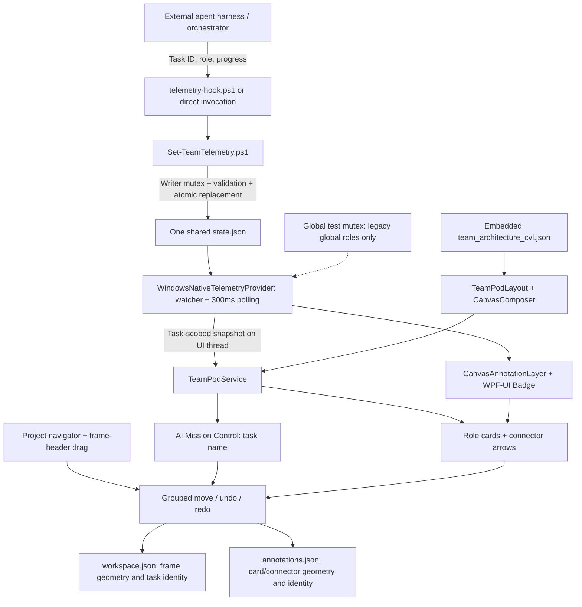
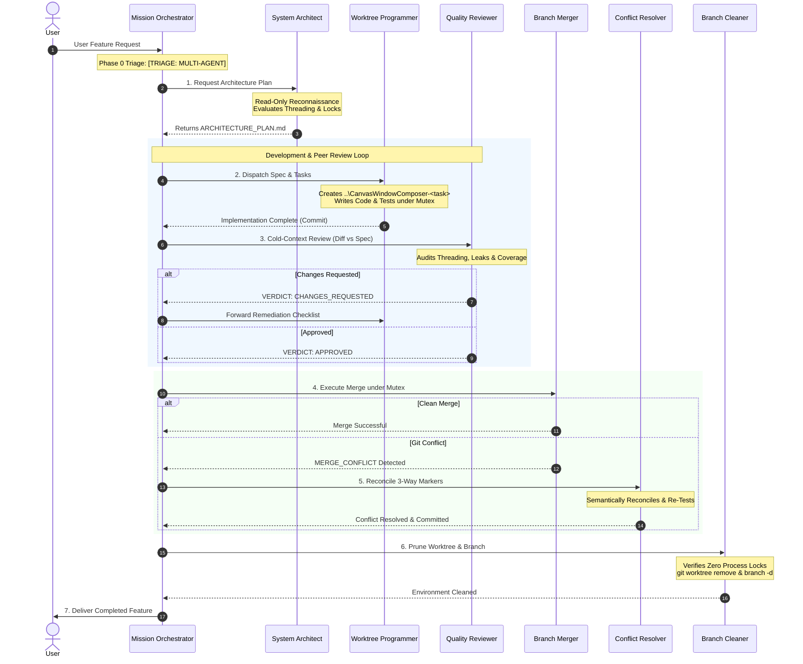

# AI Mission Control: Multi-Agent Spatial Telemetry & Orchestration Engine

> **CanvasWindowComposer as an AI Operating System & Live Mission Deck**
> *Transforming autonomous coding agents into real-time, visual spatial workflows on your desktop canvas.*

---

## 1. Executive Overview

**AI Mission Control** is a vendor-neutral, multi-agent software engineering rig and real-time visual telemetry engine integrated directly into **CanvasWindowComposer**.

Historically, when autonomous coding agents (such as Google Antigravity, Gemini CLI, Claude Code, Windsurf/Codium, or OpenCode) work on complex features, their internal progress—planning, editing, testing under locks, reviewing diffs, and resolving merge conflicts—remains trapped inside text chat windows and terminal logs.

AI Mission Control bridges this gap by turning your infinite spatial desktop into an **active mission control deck**:

1. **Team Workflow Guidance**: Defines specialized agent roles, isolated worktrees, and peer review loops for a configured external agent harness. Canvas itself does not launch agents or infer tasks from conversations.
2. **Lifecycle Telemetry**: Accepts task registration and progress through a PowerShell command or configured lifecycle hooks.
3. **Task-Specific Canvas Pods**: Materializes one saved mission-control frame per registered task, with role cards, connectors, animated glows, and Fluent status/detail pills.
4. **Persistent Spatial Control**: Lets users find a pod in the project navigator and drag its frame to move the group in one undoable operation.
5. **Vendor-Neutral Reporting**: Uses a shared JSON file that external tools can update. The supplied hook recognizes .NET test commands; other harnesses and test runners need explicit integration.

The delivered task-pod implementation was merged in [PR #33](https://github.com/schnepg1/CanvasWindowComposer/pull/33).
For a shorter operational runbook, see [Agent team pods](team-pods.md).

---

## 2. End-to-End System Architecture



The host targets .NET 10 on Windows and uses the installed WPF-UI 4.3.0 package.
The role/workflow diagrams below describe how an external harness can organize
agents; the canvas runtime consumes their telemetry and manages the visualization.


---

## 3. The 7-Role Multi-Agent Team Rig

For non-trivial features, the system splits engineering labor across specialized roles defined in [`.agents/skills/`](../.agents/skills/) and [`.agents/teams/teams.yaml`](../.agents/teams/teams.yaml). Each role operates with isolated context to eliminate confirmation bias and context rot:



### Role Catalog

| Role | Skill Directory | Workspace Mode | Core Responsibility |
| :--- | :--- | :--- | :--- |
| **Mission Orchestrator** | *Root Session* | `inherit` | Holds macro state machine; never touches code; routes tasks between agents. |
| **System Architect** | [`.agents/skills/architect-planning`](../.agents/skills/architect-planning) | `inherit` (read-only) | Codebase reconnaissance; authors atomic task blueprints (`ARCHITECTURE_PLAN.md`). |
| **Worktree Programmer** | [`.agents/skills/worktree-developer`](../.agents/skills/worktree-developer) | `isolated-worktree` | Creates isolated branch and worktree; writes production code and unit tests. |
| **Quality Reviewer** | [`.agents/skills/code-reviewer`](../.agents/skills/code-reviewer) | `inherit` (read-only) | Cold-context review of diff vs. plan; audits thread dispatching and resource safety. |
| **Branch Merger** | [`.agents/skills/branch-merger`](../.agents/skills/branch-merger) | `target-checkout` | Verifies reviewer approval; synchronizes branches; merges under test mutex. |
| **Conflict Resolver** | [`.agents/skills/conflict-resolver`](../.agents/skills/conflict-resolver) | `merge-workspace` | Exception handler; semantically reconciles 3-way git conflicts and re-verifies. |
| **Branch Cleaner** | [`.agents/skills/worktree-cleaner`](../.agents/skills/worktree-cleaner) | `inherit` | Audits process locks (`CanvasDesktop`, `dotnet`, `testhost`); prunes worktrees and branches. |

---

## 4. Phase 0: Dynamic Reconnaissance & Triage Protocol

The following is a suggested triage protocol for a harness using the team rig.
It is not an automatic Canvas behavior or an additional requirement imposed by
[`AGENTS.md`](../AGENTS.md), which governs worktree isolation and safe test execution:

1. **Read-Only Codebase Reconnaissance**:
   - Locates symbols, interfaces, and call sites without modifying files.
2. **Dynamic Blast Radius Evaluation**:
   - Spans $> 2–3$ files or multiple subsystem boundaries?
   - Involves native OS handles (Win32 HWND, D3D, DWM, hooks) or WPF `Dispatcher` concurrency?
   - Requires serialized desktop integration tests under machine-wide mutexes?
   - High risk of regression or merge conflict on target branch?
3. **Decision Gate**:
   - **All NO** $\to$ `[TRIAGE: SOLO]` (Execute directly in single worktree).
   - **Any YES** $\to$ `[TRIAGE: MULTI-AGENT]` (Promote to Architect and launch team).

---

## 5. Delivered Telemetry and Registration Pipeline

### A. Register a Task and Report Progress

An agent or orchestrator chooses a stable task ID and calls
[`.agents/scripts/Set-TeamTelemetry.ps1`](../.agents/scripts/Set-TeamTelemetry.ps1).
The first task-scoped update creates the registration; later updates reuse it.
Different task IDs produce separate pods. Task IDs must match their `teams` keys
when explicitly supplied in JSON.

```powershell
# Use the same absolute path in Canvas and every agent's environment.
$env:CANVAS_TEAM_STATE_PATH = 'C:\Projects\CanvasWindowComposer\.agents\teams\state.json'
.agents\scripts\Set-TeamTelemetry.ps1 -TaskId task-window-linking-01 `
  -Name 'Feature: Window Linking' -Role architect -State Working -Detail 'Planning window links'
.agents\scripts\Set-TeamTelemetry.ps1 -TaskId task-window-linking-01 `
  -Role programmer -State Working -Detail 'Editing WindowManager.cs'
.agents\scripts\Set-TeamTelemetry.ps1 -TaskId task-window-linking-01 `
  -Role reviewer -State Testing -Detail 'Running mutex tests'
.agents\scripts\Set-TeamTelemetry.ps1 -TaskId task-window-linking-01 `
  -Role orchestrator -State Done -Detail 'Phase complete' -TaskStatus Done
```

`Done` on a role finishes that phase; `-TaskStatus Done` marks the task itself
complete. Task completion leaves the saved pod in place. Calling the helper
without a task ID updates legacy global roles and does not register a pod.

### B. Lifecycle Hook Integration

Configure the external harness to invoke
[`.agents/scripts/telemetry-hook.ps1`](../.agents/scripts/telemetry-hook.ps1).
Set `CANVAS_TASK_ID` and optionally `CANVAS_TASK_NAME`, or pass `-TaskId`,
`-TaskName`, and `-Role` explicitly. The role defaults to `programmer`.

* **`PreToolUse`**: Reports Working, or Testing when the command matches
  `Run-Tests|dotnet test`; recognized file tools supply a more useful detail.
* **`Stop`**: Reports Done for this invocation's task and role. It leaves other
  roles and other tasks unchanged.
* The hook reads a JSON tool payload from redirected stdin, delegates writes to
  the helper, reports failures on stderr, and writes `{}` to stdout.

The current checkout does not ship `.agents/hooks.json` or a
`telemetry-hook.cmd` wrapper. Configure the lifecycle command using the actual
hook schema of the selected harness; installation of `.agents/` alone does not
enable hooks in every agent product.

### C. Shared State and Task Isolation

```json
{
  "teams": {
    "task-window-linking-01": {
      "name": "Feature: Window Linking",
      "taskId": "task-window-linking-01",
      "status": "Active",
      "activeRole": "programmer",
      "roles": {
        "architect": { "state": "Done", "detail": "Spec approved" },
        "programmer": { "state": "Working", "detail": "Editing WindowManager.cs" }
      }
    }
  },
  "roles": {
    "programmer": { "state": "Idle", "detail": "Legacy global card" }
  }
}
```

The shared contract lives in [TeamTelemetry.cs](../Modules/CanvasView/TeamTelemetry.cs)
and [TeamTelemetryJson.cs](../Modules/CanvasView/TeamTelemetryJson.cs). New cards
persist `AgentTaskId` and `AgentRole`; bound cards resolve only their own task's
report, independently of their displayed text. A registered Active task's
`activeRole` defaults to Working when no role report exists; other unreported
roles show Idle. Legacy cards retain text-based matching against global roles.
The reader does not use `activeTaskId` to choose a single team.

### D. Cross-Worktree State Path and Recovery

Canvas watches one resolved state file. It does not merge multiple files or
require dual writes. Set `CANVAS_TEAM_STATE_PATH` before starting Canvas and
in every agent environment, using a common absolute path across worktrees.
The helper also accepts `-StatePath`; its default is the repository's
`.agents/teams/state.json` beside the team templates.

Without an explicit path or the environment override, Canvas checks existing
`.canvas/state.json` and `.agents/teams/state.json` files in the working and
application directories, then `%APPDATA%\CanvasWindowComposer\Teams\state.json`.
If no file exists, it falls back to the working repository's `.agents/teams`
when `.agents` exists, otherwise AppData.

[WindowsNativeTelemetryProvider](../Source/Workspace/WindowsNativeTelemetryProvider.cs)
handles creation, change, deletion, and rename events. Its 300 ms polling also
finds files or directories created after startup and recovers missed events.
Malformed or partial writes retain the last valid snapshot. The snapshot is
marshaled to the UI thread before creating pods or refreshing visuals.

### E. Atomic Writes and Reader Limits

All supplied writers serialize updates with a named mutex derived from the
absolute state path, preserve other registrations and legacy roles, and replace
the file atomically. The helper validates the candidate under that lock before
writing a temporary file or replacing the destination:

| Limit | Behavior |
| :--- | :--- |
| 64 task registrations | Completed and archived tasks count; existing-task updates remain allowed at capacity. |
| 64 roles per task or global role map | Reject a candidate exceeding either map limit. |
| 1 MiB of UTF-8 data | Count encoded bytes, including preserved fields and multibyte characters. |
| 1,000 characters in a generated worktree path | Reject an oversized path before publishing its report. |

A rejected update reports an error and preserves the valid file's exact bytes.
There is no automatic pruning: explicitly remove an obsolete registration before
adding a task beyond capacity. This addresses the Codex review finding in PR #33
that a 65th task could otherwise make the entire file unreadable after restart.
Runtime `state.json` and temporary state files are ignored by git.

---

## 6. Configuration Boundaries and Test Mutex

The installed provider probes `Global\CanvasWindowComposer.Tests` every 300 ms.
Because this machine-wide mutex cannot identify a task, it only overrides legacy
global programmer/reviewer cards to Testing. Releasing it restores their reported
state; it never sets unrelated task cards to Testing.

The supplied hook recognizes .NET test commands. Other test runners can call
`Set-TeamTelemetry.ps1 -State Testing -Detail ...` explicitly, or extend the
harness's hook integration. The current implementation does not load
`mutex_name`, `test_command_pattern`, or `cvl_template` from `teams.yaml`, and
there is no `TeamTelemetryConfig.cs` parser or zero-polling configuration mode.
Those remain possible extensions rather than delivered configuration switches.

The telemetry contracts and layout use BCL APIs; the status UI uses the existing
WPF-UI dependency. This feature did not add a new NuGet package or change locked
package versions.

---

## 7. Canvas Pods, Status Pills, and Permanent Placement

### A. Automatic Task Pod Materialization

[TeamPodService](../Source/Workspace/TeamPodService.cs) reconciles registered tasks
on the UI thread. [TeamPodLayout](../Modules/CanvasView/TeamPodLayout.cs) uses the
embedded [CVL team template](../.agents/teams/team_architecture_cvl.json) and
`CanvasComposer.Prepare` to produce seven role cards, nine bound connector arrows,
and the template's three background annotations inside a single master project
area named **AI Mission Control: <task name>**.

Stable per-desktop/task identities make repeated telemetry updates reuse the saved
pod. New pods are placed beside existing canvas contents; existing pod positions
are never reset by telemetry. Pods stay on the desktop where first created and
remain after completion. Registration creation is also an undoable group with
its frame.

The runtime uses `TeamPodService`, not an `AiOperationsSectorManager`. There is
currently no dedicated “AI Teams Mission Control” toolbelt toggle; use the project
navigator to find and frame the saved mission-control area.

### B. Fluent Status and Detail Pills

[CanvasAnnotationLayer](../Source/Overlays/Overview/CanvasAnnotationLayer.cs) renders
live glows and cached [TelemetryStatusPill](../Source/Overlays/Overview/TelemetryStatusPill.cs)
artwork using the installed [WPF-UI](https://github.com/lepoco/wpfui) 4.3.0 `Badge`
control. Each pill carries a text state and optional detail, for example
`● WORKING · Editing WindowManager.cs`.

| State | Pill and Glow Color | RGB Hex | Meaning |
| :--- | :--- | :--- | :--- |
| **Idle** | Gray pill | `#94A3B8` | Registered role has no active report; no animated glow. |
| **Working** | Cyan / Sky Blue | `#38BDF8` | Planning, editing, or executing tools. |
| **Testing** | Amber | `#F59E0B` | Reported test execution; legacy cards may also reflect the global mutex. |
| **Blocked** | Orange | `#FB923C` | Waiting for review or confirmation. |
| **Done** | Emerald | `#10B981` | Phase completed successfully. |
| **Error** | Red | `#EF4444` | Reported failure or conflict. |

Task cards reserve header space for the pill; legacy cards show it just above
the artwork. Long details truncate within the available width. Pills and text
follow canvas zoom and DPI. Glow animation respects reduced motion and pauses
during camera motion.

### C. Move, Undo, and Persist the Whole Container

Open the interactive canvas, including at 100% zoom, and locate the mission-control
area in the project navigator. Drag its outlined header to move cards, connectors,
nested areas, and member windows together. Header drags use the existing grouped
selection transaction instead of moving annotations individually before the
workspace move succeeds. Undo and redo restore the group and frame together.

Task identity keeps cards linked to the container and their telemetry after
renaming or moving them outside the frame. Geometry and identity persist in:

* `workspace.json`: master frame bounds and `AgentTaskId`.
* `annotations.json`: card and connector bounds, `AgentTaskId`, and `AgentRole`.

The normal desktop view hides canvas overlays. Enter the interactive canvas to
see and manipulate borders; permanent placement means saved coordinates across
app restarts, not an always-visible overlay above desktop applications.

---

## 8. Quickstart

1. Keep CanvasWindowComposer and the configured agent harness available. Set a
   common `CANVAS_TEAM_STATE_PATH` for Canvas and every agent before starting them.
2. Use the registration commands in section 5 to publish a stable task ID and role.
   Another task ID creates a separate pod with independent progress.
3. For automatic reporting, configure the harness to invoke `telemetry-hook.ps1`
   with the correct task and role; for other test runners, report Testing explicitly.
4. Open the interactive canvas and find **AI Mission Control: <task name>** in the
   project navigator. Inspect the pills and drag the frame to choose its saved position.
5. Report Done for the completed role, and use `-TaskStatus Done` when the task is
   complete. The pod remains in place for reference.

The role skills and junction helper remain available under `.agents/` for harnesses
that discover those directories. Copying the scripts to another project supports
reporting into the shared file; the visualization template is embedded in the
Canvas build rather than loaded from an arbitrary project's configuration.

---

## 9. Verification and Delivery Record

[PR #33](https://github.com/schnepg1/CanvasWindowComposer/pull/33) delivered task-scoped
registration, stable pod materialization, Fluent status/detail pills, grouped
container movement, persistence, and the reader-limit review fix. It was merged
into `main` as `0d0f4ac`.

| Verification | Recorded result |
| :--- | :--- |
| Locked restore and full Windows Release build, including x64/x86 native binaries | Passed during PR validation. |
| Headless AI/telemetry suite | 93 tests passed, including the review-fix validation. |
| New Windows pod/badge tests | All 8 passed in the PR run before the writer-limit fix. |
| PowerShell integration checks | Passed; cover concurrent writers, legacy compatibility, Stop isolation, updates at capacity, rejection without file changes, role limits, and multibyte UTF-8 limits. |
| Full Windows/UI suite before the writer-limit fix | 63 failing tests also failed on the unchanged base `main`; this was not a fully green CI run. |

These are recorded implementation checks, not a claim about the status of future
CI runs. Relevant tests are [TeamTelemetryTests](../Tests/Ai/TeamTelemetryTests.cs),
[TeamPodTests](../Tests/TeamPodTests.cs), and
[Test-TeamTelemetry.ps1](../Tests/Test-TeamTelemetry.ps1).

To verify reporting and parsing changes:

```powershell
pwsh -NoProfile -File Tests/Test-TeamTelemetry.ps1
dotnet test Tests/Ai/CanvasDesktop.Ai.Tests.csproj -c Release
```

For Windows rendering and desktop checks, follow the serialized test runner in
[`AGENTS.md`](../AGENTS.md):

```powershell
powershell -NoProfile -ExecutionPolicy Bypass -File Tools/Run-Tests.ps1 -Configuration Release -NoPrompt
```

---

*Groundwork documentation: Antigravity Mission Orchestration Rig.*
*Updated with the task-pod implementation and review fix delivered in PR #33.*
*Repository: `schnepg1/CanvasWindowComposer`.*
