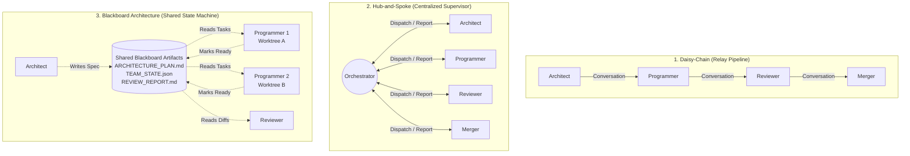
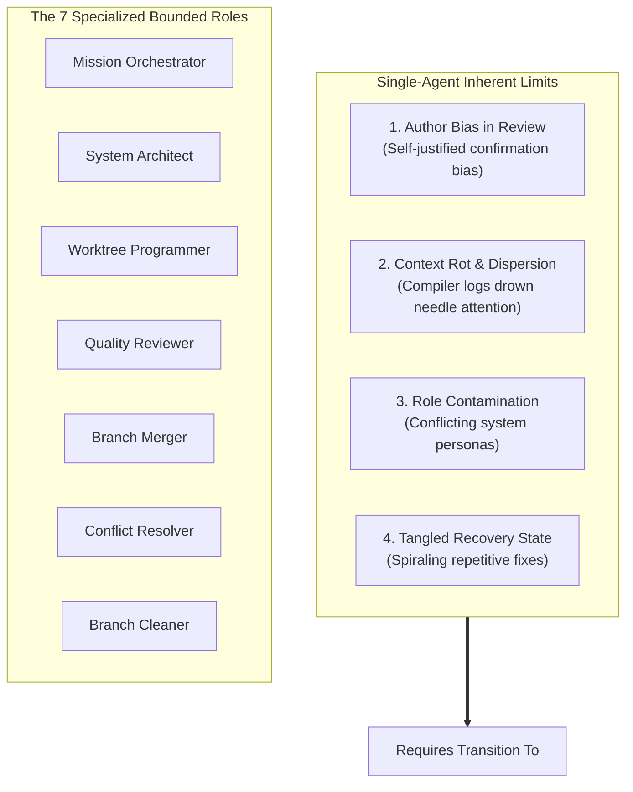
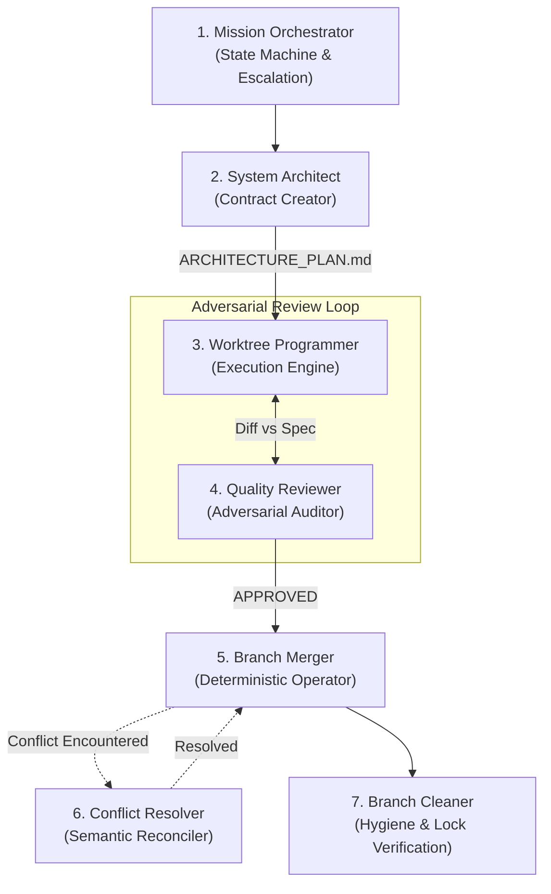
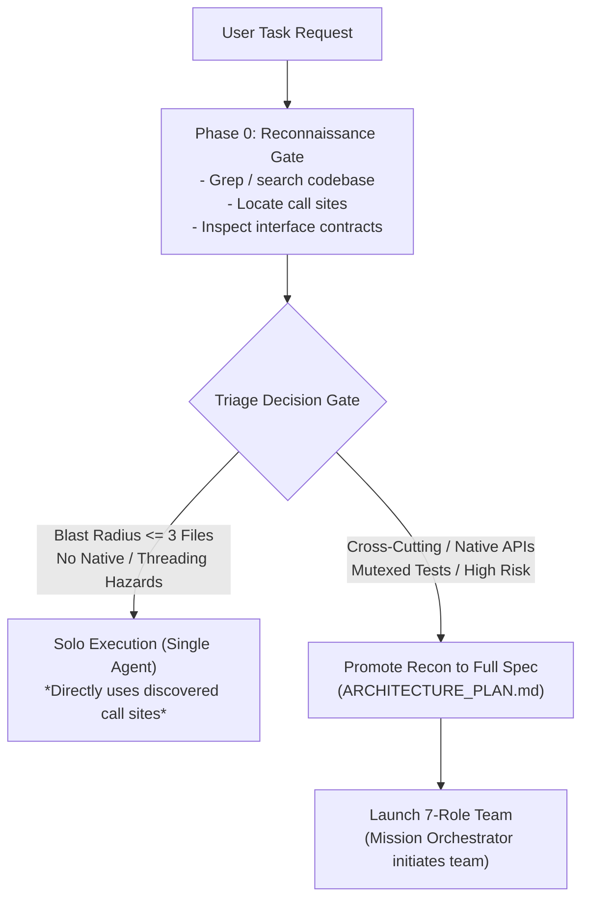
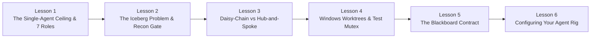

# AI Agent Orchestration Theory & Architecture Patterns

> **Foundational Engineering Guide & Learning Module Blueprint**  
> *Understanding multi-agent topologies, context economy, error recovery, and spatial telemetry in production software systems.*

---

## 1. Executive Introduction

When developers first experiment with autonomous AI agents, they typically begin with a **monolithic single-prompt workflow**: a single Large Language Model (LLM) session tasked with understanding requirements, exploring a codebase, writing code, executing tests, reviewing diffs, and committing changes.

While this approach works for toy scripts, it rapidly collapses when applied to enterprise-grade, compiled, native software repositories like **CanvasWindowComposer**. Single agents suffer from **context window bloat**, **attention drift**, **confirmation bias** (approving their own broken code), and **destructive environment interference** (file locks, native desktop window collisions).

To overcome these failure modes, modern AI development has transitioned to **Multi-Agent Orchestration**: coordinating a team of specialized, bounded AI roles working in concert. 

However, orchestrating agents is not merely a question of prompting; it is an architectural discipline governed by state machines, dependency graphs, concurrency boundaries, and token economics. 

This document establishes the theoretical foundation for agent coordination, answers critical architectural questions, and outlines the blueprint for an interactive **On-Canvas Learning Module** that enables users to understand, observe, and customize agent team coordination.

---

## 2. Core Coordination Topologies

Every multi-agent engineering system implements one of three fundamental topologies—or a hybrid combination of them:

1. **Daisy-Chain (Relay Pipeline)**: Sequential, agent-to-agent conversational handoff.
2. **Hub-and-Spoke (Centralized Supervisor)**: Central orchestrator managing discrete subagent dispatches and feedback loops.
3. **Blackboard Architecture (Shared State Machine)**: Persistent structured artifacts acting as the single source of truth, decoupling agent communication from agent execution.



---

## 3. Deep Dive: Hub-and-Spoke vs. Daisy-Chain

A common intuitive assumption among engineers is:
> *"Can we save tokens and make agent orchestration simpler by letting subagents spawn each other in a daisy-chain (Orchestrator $\to$ Architect $\to$ Programmer $\to$ Reviewer), rather than routing everything back through a central orchestrator?"*

Empirical testing and software engineering realities prove that **this assumption is false**. Daisy-chain handoffs drastically decrease reliability and, counter-intuitively, inflate token consumption.

### 3.1 Why Reliability Drops Dramatically in a Daisy Chain

#### A. Software Lifecycles are Cycles, Not Linear Pipelines
Real software development is an iterative feedback loop:

$$\text{Programmer} \xrightarrow{\text{code}} \text{Reviewer} \xrightarrow{\text{CHANGES\_REQUESTED}} \text{Programmer}$$

* **In Hub-and-Spoke**: The Orchestrator manages a clean numerical counter (`review_iteration: 2/5`) and re-dispatches the Programmer with the Reviewer's structured feedback report. The state machine remains flat and deterministic.
* **In a Daisy Chain**: The Reviewer must either recursively spawn a *new* Programmer (creating deep grandchild agent hierarchies) or attempt to pass control backwards up an active prompt call stack. Uncontrolled nested recursion frequently triggers platform depth limits, orphaned processes, and context corruption.

#### B. Exception Routing & The "Broken Telephone" Problem
Software engineering is rife with non-linear environmental failures: git merge conflicts, compilation errors, locked Windows handles, and test timeouts.

* **In Hub-and-Spoke**: If the Branch Merger encounters a merge conflict, it halts and reports `STATUS: CONFLICT` to the Orchestrator. The Orchestrator evaluates its transition table and spins up the specialized **Merge Conflict Resolver** agent.
* **In a Daisy Chain**: The Branch Merger has to decide who to spawn next or unwind 4 levels of nested agent calls back to the Architect. If any agent in the chain hallucinates or drops context, the entire mission deadlocks with zero recovery path.

#### C. Telemetry and Observability Breakdown
In a visual desktop environment like CanvasWindowComposer, agent state must be broadcast to the UI (`state.json`) so cards glow and status pills render accurately.

* **In Hub-and-Spoke**: The Orchestrator acts as the single source of telemetry truth (single writer), avoiding concurrency races.
* **In a Daisy Chain**: Every individual subagent must be explicitly instrumented to know how to write telemetry, compute overall pipeline progress, and signal status changes.

---

### 3.2 The "Token Savings" Illusion

It is easy to believe that removing the Orchestrator "middleman" reduces token costs. In practice, the opposite occurs due to **Downstream Context Accumulation**.

#### 1. The Orchestrator's Context is Negligible
The Orchestrator never loads 50,000 lines of source code, Roslyn ASTs, or compiler logs. Its context window contains only:
* The high-level state machine specification (`workflow.yaml`).
* Compact status transition messages (`"Task 1: Plan Approved"`, `"Commit: 8264a91"`).
* Its token footprint typically represents **less than 5%** of the total multi-agent mission cost.

#### 2. Daisy Chains Suffer from Snowballing Context
In a daisy-chain, each agent must forward accumulated history to the next agent:
1. **Architect** forwards the 2,000-word design plan to **Programmer**.
2. **Programmer** must forward the design plan + its command history + build logs + commit hashes to **Reviewer**.
3. **Reviewer** forwards all of the above + its review feedback + test diffs to **Merger**.
4. By the time the pipeline reaches the **Branch Cleaner**, it carries an overwhelming context payload of 40,000+ tokens just to execute `git worktree remove`.

$$\text{Total Daisy-Chain Context} = \sum_{i=1}^{N} \text{Context}_i = \mathcal{O}(N^2) \quad \text{vs.} \quad \text{Hub-and-Spoke} = \sum_{i=1}^{N} (\text{Orchestrator} + \text{Role}_i) = \mathcal{O}(N)$$

By contrast, in Hub-and-Spoke, every subagent receives a **pruned, bounded context domain** containing strictly what is necessary for its immediate job, discarding downstream baggage.

---

## 4. Blackboard Architecture: Shared Documents as Single Source of Truth

What happens when we transition from conversational message passing to a **structured team document** on disk (such as `ARCHITECTURE_PLAN.md` or `TEAM_STATE.json`)?

This transforms the coordination model into a **Blackboard Architecture (Shared State Machine)**.

```mermaid
flowchart LR
    subgraph Blackboard ["Blackboard State Contract"]
        Plan["ARCHITECTURE_PLAN.md<br/>- Task 1: [x] Done (Branch A)<br/>- Task 2: [ ] In Progress (Branch B)<br/>- Task 3: [ ] Pending"]
        State["state.json<br/>- Global Phase: EXECUTION<br/>- Mutex: Released"]
    end

    Agent1["Worker Agent 1"] <-->|Claim & Check off Task 1| Blackboard
    Agent2["Worker Agent 2"] <-->|Claim & Check off Task 2| Blackboard
    Supervisor["Watchdog / FileSystemWatcher"] -->|Monitor Transitions| Blackboard
    Canvas["Canvas Visual Deck"] <--|Render UI| Blackboard
```

### 4.1 What Changes with a Blackboard Architecture?

1. **Decoupled Handoffs (Zero Conversational Telephone)**:  
   Agents no longer need to pass chat payloads to one another. Agent A completes its assigned section, writes diffs, and marks `[x] READY_FOR_REVIEW` in the blackboard document. Agent B inspects the document directly to begin work.
2. **Unlocks True Multi-Agent Concurrency**:  
   In a pure conversational chain, execution is strictly serial. With a structured blackboard, an Architect can partition a feature into three independent subtasks. Three developer agents can launch simultaneously in **separate git worktrees**, each claiming an unassigned checklist item without blocking the others.
3. **Total Crash Resilience & Model Agnosticism**:  
   If an agent hits an API rate limit, crashes, or exhausts its context window, nothing is lost. The durable state lives on disk. A user can even switch LLM models mid-flight: an Antigravity agent can draft the plan, Claude Code can implement Task 1, and Gemini CLI can resolve Task 2, all coordinated through the same blackboard document.
4. **Self-Guiding Event Watchdogs**:  
   The Orchestrator no longer needs to micromanage every parameter. It acts as an event watchdog (using `FileSystemWatcher`) that reacts only when state transitions occur on disk.

### 4.2 What Stays the Same (Inviolable Logical Invariants)

Even with decoupled blackboard coordination, **the causal dependency graph (DAG) cannot be violated**:
* A Reviewer cannot run before a Programmer commits code.
* A Branch Merger cannot merge before the Reviewer sets `[x] APPROVED`.
* Tests requiring native window handles cannot overlap, regardless of how many parallel agents are running.

---

## 5. The Genesis of the 7-Role Team: Single-Agent Limits vs. Multi-Agent Specialization

A fundamental question arises in modern AI-assisted engineering:
> *"If we have access to frontier reasoning models (e.g. Gemini 3.8 Flash with high thinking, GPT-5 / GPT-6.1 Sol class) and massive 1M–2M+ token context windows, why can't a single agent follow a comprehensive skill and execute the entire lifecycle (Plan $\to$ Isolate $\to$ Code $\to$ Test $\to$ Review $\to$ Merge $\to$ Resolve $\to$ Clean) by itself?"*

The answer touches the core architecture of transformer-based attention models: **scaling model intelligence and context capacity does not eliminate the physical and behavioral failure modes of single-session execution.**



### 5.1 The Four Fundamental Failure Modes of Single Agents

#### A. The "Author Bias" in Code Review
* **In a single agent**: The model that wrote the code spent thousands of thinking tokens justifying its implementation choices, shortcuts, and edge-case dismissals. Asking that identical context session to review its own work produces superficial, lenient approvals (*"Looks clean, robust, and modular!"*). The attention heads are conditioned by their own prior generation.
* **In a multi-agent team**: The **Quality Reviewer** receives only the specification (`ARCHITECTURE_PLAN.md`) and the Git diff (`git diff target...branch`). It possesses zero prior attachment or rationalizations, auditing the changes with authentic adversarial skepticism.

#### B. Context Degradation ("Context Rot" & Attention Dispersion)
* While frontier models can retrieve needles in a 1M+ haystack, **reasoning fidelity and instruction adherence deteriorate** as the context fills with operational debris.
* Compiling .NET code, executing test runners (`Tools\Run-Tests.ps1`), analyzing stack traces, and iteratively debugging dumps tens of thousands of tokens of raw stdout/stderr into conversation history.
* When that single agent finally reaches the **Branch Merger** or **Conflict Resolver** phase, its attention is dispersed across thousands of lines of compiler logs. It frequently misses subtle edge cases, forgets worktree cleanup commands, or hallucinates paths.

#### C. Role Contamination and Prompt Bloat
* An agent instructed to be simultaneously:
  1. A visionary high-level architect,
  2. An aggressive test-driven developer,
  3. A pedantic, adversarial security and memory auditor, and
  4. A cautious Git plumbing and process cleanup operator
  suffers from persona dilution. Conflicting instructions weaken the rigor of each individual stage.

#### D. Rollback and Error Recovery State Traps
* When a single agent encounters a test failure or merge conflict, its conversation history becomes a tangled knot of discarded attempts and wrong turns. LLMs exhibit a documented tendency to spiral into repetitive, ineffective fixes once trapped in an error-laden context.
* In a multi-agent rig, subagents are **ephemeral scratchpads**. If the Programmer produces flawed code, the Orchestrator discards the scratchpad, passes the Reviewer's structured critique, and can even spin up a fresh Programmer instance with clean context.

---

### 5.2 The 7 Specialized Roles & Why Each Demands Separation



| Role | Operational Scope | Why It Demands Separation |
| :--- | :--- | :--- |
| **1. Mission Orchestrator** | High-level state machine (`workflow.yaml`), agent dispatch, and user escalation. Never touches code or git directly. | Keeps its context tiny ($< 5\%$ tokens) and hyper-focused on transition logic without being polluted by compiler output. |
| **2. System Architect** | Inspects codebase patterns, Win32/WPF constraints, and drafts `ARCHITECTURE_PLAN.md` with atomic checklists. | Keeps design purely high-level; does not get bogged down in build errors, syntax details, or git mechanics. |
| **3. Worktree Programmer** | Creates isolated git worktree, writes implementation code, writes tests, and runs build/test loops. | Burns through token volume running tools; isolating it prevents build noise from polluting downstream reviewers. |
| **4. Quality Reviewer** | Adversarially audits git diff against the architectural spec. Audits HWND leaks, mutex releases, and dispatcher safety. | Possesses **zero author bias**; evaluates code with cold objectivity, unaffected by the programmer's internal rationalizations. |
| **5. Branch Merger** | Validates reviewer approval, verifies target branch freshness, and merges (`git merge --no-ff`) under the test mutex. | Git merges require strict mechanical precision without fatigue-induced shortcuts. |
| **6. Conflict Resolver** | Specialist spun up **only** when a 3-way merge encounters syntactic or semantic conflicts. | 3-way reconciliation requires a unique prompt focusing on dual-intent preservation; shouldn't bloat standard merge agents. |
| **7. Branch Cleaner** | Checks for open file handles (`dotnet.exe`, `testhost.exe`, `CanvasDesktop.exe`), removes worktree, and deletes branch. | Windows locks prevent folder deletion; requires dedicated lock inspection to avoid silent workspace corruption. |

---

### 5.3 Single Agent + Master Skill vs. 7-Role Team: Decision Boundaries

| Dimension | Single Agent + Master Skill | 7-Role Multi-Agent Team |
| :--- | :--- | :--- |
| **File Blast Radius** | $\le 2 - 3$ files in a single subsystem | Multi-file, cross-subsystem, or architectural changes |
| **System Impact** | Safe user-space code; low regression risk | Low-level / native APIs (HWND, Win32 hooks, D3D, WPF Dispatcher) |
| **Test Complexity** | Fast, in-memory unit tests | Serialized native test suites under machine-wide mutexes |
| **Context Longevity** | Fits comfortably in $\le 30\text{k} - 50\text{k}$ tokens | Long trajectory requiring multiple tool invocations and builds |
| **Merge Surface** | Direct fast-forward merge on static branch | Concurrent active development; risk of merge conflicts |
| **Review Standard** | Self-verification is sufficient | Strict enterprise compliance; adversarial audit mandatory |
| **Human Time Scale** | $< 15$ minutes of human engineering | Hours or days of engineering labor |

---

## 6. The "Iceberg Problem" & The Reconnaissance Gate Pattern

A critical practical challenge in autonomous software engineering is:
> *"Can an AI agent immediately know from the user's initial prompt whether it should execute the task solo or launch the full 7-role multi-agent team?"*

The short answer is **no**. Prompts suffer from the classic **"Iceberg Problem"**: the user's prompt is merely the visible tip above water, while the codebase's existing architecture, dependencies, and native constraints represent the massive hidden reality beneath the surface.



### 6.1 The Trap of "Prompt-Only" Triage

If an agent attempts to route execution based solely on the text of the prompt, it reliably makes two catastrophic mistakes:

1. **False Negative (The Hidden Iceberg)**:
   * *User Prompt*: `"Make sure the window doesn't flicker when moving to a secondary monitor."`
   * *Codebase Reality*: Involves D3D/DWM swapchains, cross-DPI scaling calculations, Win32 `WM_WINDOWPOSCHANGING` hooks, and WPF dispatcher synchronization.
   * *Prompt-Only Outcome*: A solo agent attempts the fix, gets lost in compiler errors and native memory crashes, pollutes its context, and fails.
2. **False Positive (The Unnecessary Fleet)**:
   * *User Prompt*: `"Refactor our global shortcut handling system to support custom modifier keys."`
   * *Codebase Reality*: The repository already has a clean `IHotkeyService` abstraction; the task requires only adding an enum value and one dictionary entry.
   * *Prompt-Only Outcome*: The agent burns 10 minutes and hundreds of thousands of tokens spinning up 7 subagents across isolated worktrees for a 12-line change.

The only prompts an agent can route without inspecting the codebase are the extreme edges:
* **Immediate Solo**: Typo fixes, pure documentation edits, updating package versions.
* **Immediate Team**: Designing brand-new subsystems from scratch (*"Implement a WebAssembly plugin engine"*).

For everything in the middle (**80% of real-world tasks**), prompt-only triage fails.

---

### 6.2 The Reconnaissance Gate Architecture

To solve this, the agent must execute a lightweight **Phase 0: Reconnaissance** before committing to an orchestration mode:

1. **Grep and Search**: Rapidly find call sites, class hierarchies, and existing abstractions.
2. **Evaluate Blast Radius**: Determine how many assemblies, native interfaces, or test categories are impacted.
3. **Route Deterministically**:
   * If simple $\to$ **Solo Execution**. The agent already found the exact files and lines during recon, so it performs the edit immediately with zero wasted effort.
   * If complex $\to$ **Team Execution**. The agent promotes its reconnaissance findings directly into `ARCHITECTURE_PLAN.md`, handing the contract to the Mission Orchestrator.

### 6.3 Concrete Triage Scoring Rubric

#### Solo Execution Rubric (All must be true):
- [ ] **File Footprint**: Touches $\le 2 - 3$ isolated files within the same assembly.
- [ ] **Resource Safety**: Zero native OS handles (`HWND`, GDI/D3D, window hooks), no cross-thread WPF dispatchers, and no shared static state.
- [ ] **Verification Velocity**: Verified exclusively by fast, in-memory unit tests (no serialized desktop runners or named mutexes needed).
- [ ] **Git Surface**: Zero likelihood of merge divergence against target branch.

#### Multi-Agent Team Rubric (Any one triggers the team):
- [x] **Cross-Cutting**: Modifies interfaces or models spanning multiple projects or layers.
- [x] **Native / Threading Hazards**: Interacts with Win32 APIs, window hooks, DWM thumbnails, or WPF Dispatcher synchronization.
- [x] **High-Stakes Testing**: Requires running serialized integration test suites (`Tools\Run-Tests.ps1` with `Global\CanvasWindowComposer.Tests`).
- [x] **Adversarial Audit Required**: High regression risk where author confirmation bias could overlook resource leaks or deadlocks.
- [x] **Merge Conflict Probability**: Long-running feature branch or high-churn shared files.

---

## 7. Architectural Heritage: From OpenRig to CanvasWindowComposer

The architecture implemented in `.agents/` is derived directly from the open-source **OpenRig** pattern (`mvschwarz/openrig`), adapted specifically for the realities of Windows desktop engineering and spatial visualization.

### 7.1 What Matches OpenRig

1. **Declarative Team Topologies**: Defining team structures, roles, and transitions in declarative YAML configurations (`teams.yaml`, `workflow.yaml`) rather than hardcoding agent logic in scripts.
2. **The Lead Agent / Supervisor Pattern**: Centering operations around a supervisor that enforces the macro state machine and delegates bounded sub-tasks to specialists.
3. **Role Specialization & Bounded Contexts**: Strictly isolating domains of competence (Architect $\to$ Developer $\to$ Reviewer $\to$ Merger) so no single agent suffers from context contamination.

### 7.2 How CanvasWindowComposer Adapts OpenRig for Windows

Standard OpenRig was conceived for POSIX systems (Linux/macOS) using background terminal daemons (`@openrig/cli`), tmux panes, and SQLite. Porting multi-agent engineering to a Windows C#/.NET 10 environment required solving unique platform challenges:

| Engineering Dimension | Standard OpenRig (POSIX) | CanvasWindowComposer Implementation |
| :--- | :--- | :--- |
| **Workspace Isolation** | Ephemeral directories or tmux panes | **Physical Git Worktrees** (`..\CanvasWindowComposer-<task>`). Avoids fatal `bin/`, `obj/`, and `TestResults/` file locking during concurrent `dotnet build`. |
| **Concurrency Lock** | Process queue / SQLite database | **Windows Named Mutex** (`Global\CanvasWindowComposer.Tests`). Serializes native desktop and HWND tests across independent worktrees. |
| **Telemetry Transport** | Background CLI daemon & SQLite | **Atomic File System Hooks** (`state.json` + `FileSystemWatcher` + named file mutex in PowerShell). |
| **Visual Layer** | Terminal dashboard (`rig_ps`) | **Infinite Spatial Canvas** (CVL JSON nodes, live WPF glow shaders, connector lines, and Fluent badges). |

---

## 8. Multi-Topology Comparison Matrix

| Dimension | 1. Daisy-Chain (Relay) | 2. Hub-and-Spoke (Supervisor) | 3. Blackboard (Shared Document) | 4. Hybrid (Canvas Rig Standard) |
| :--- | :--- | :--- | :--- | :--- |
| **Reliability** | Low (Fragile, single failure breaks chain) | High (Deterministic state transitions) | Very High (Durable on disk) | **Maximum** (Deterministic orchestration + durable blackboard) |
| **Feedback Loops** | Poor (Requires recursive agent spawning) | Excellent (Orchestrator manages loop iteration) | Excellent (Status flags in doc) | **Native** (Managed counter + documented checklist) |
| **Token Efficiency** | Poor (Context bloat accumulates downstream) | High (Each subagent gets bounded context) | High (Subagents read only relevant sections) | **Optimal** (Pruned contexts + shared artifacts) |
| **Concurrency** | None (Strictly serial $\mathcal{O}(N)$) | Moderate (Orchestrator can fan-out) | High (Parallel workers claim tasks) | **High** (Parallel worktrees + serialized test mutex) |
| **Crash Recovery** | None (Orphaned context on crash) | Good (Orchestrator restarts failed step) | Complete (Any agent can resume state) | **Complete** (Resume from `ARCHITECTURE_PLAN.md`) |
| **Telemetry & UI** | Distributed / Complex | Centralized (Single writer) | Passive (File watcher) | **Active Spatial** (`Set-TeamTelemetry.ps1` $\to$ Canvas) |
| **Best Used For** | 2-step linear read tasks (Search $\to$ Summarize) | Standard feature lifecycles | Multi-agent swarms with atomic tasks | **Compiled, native desktop software engineering** |

---

## 9. The AI Agent Orchestration Learning Module: Curriculum & On-Canvas Blueprint

To empower new users and developers to understand these patterns, understand why the CanvasWindowComposer rig makes specific decisions, and configure their own team styles, we propose a comprehensive **6-Lesson On-Canvas Curriculum**.

### 9.1 The 6-Lesson Curriculum



#### Lesson 1: The Single-Agent Ceiling & The Genesis of the 7-Role Team
* **Learning Objective**: Understand why bigger context windows and smarter models cannot solve author confirmation bias, context rot, or persona contamination.
* **Canvas Experience**: An interactive side-by-side card comparison. The user triggers a code review on a single-agent card (which approves its own broken code) vs. an adversarial Reviewer card (which catches a leaked `IntPtr` handle).

#### Lesson 2: The Iceberg Problem & The Reconnaissance Gate
* **Learning Objective**: Learn why an agent cannot know task complexity from a prompt alone, and master the Phase 0 Reconnaissance triage rubric.
* **Canvas Experience**: A simulated "Prompt Triage" puzzle. The user inputs two deceptive prompts ("Window Flicker" vs "Shortcut Refactor") and watches the Reconnaissance Gate inspect the codebase before making the routing decision.

#### Lesson 3: Communication Topologies: Chains, Hubs, and Boards
* **Learning Objective**: Visualize token accumulation ($\mathcal{O}(N^2)$ vs $\mathcal{O}(N)$), the "Broken Telephone" failure mode, and how a Hub-and-Spoke orchestrator manages review loops.
* **Canvas Experience**: An animated 3-pod playground. When a review rejection occurs in the Daisy Chain pod, the connector breaks and turns red. In the Hub-and-Spoke pod, the Orchestrator node pulses amber, increments the counter (`2/3`), and loops back cleanly.

#### Lesson 4: Windows Native Realities (.NET Locks & Named Mutexes)
* **Learning Objective**: Understand why concurrent development on Windows requires physical Git worktrees and desktop test serialization.
* **Canvas Experience**: A simulated file lock collision demonstration. Users see what happens when two builds target the same `bin/` folder vs. two isolated worktree folders, with a visual meter for `Global\CanvasWindowComposer.Tests`.

#### Lesson 5: The Contract of the Blackboard (`ARCHITECTURE_PLAN.md`)
* **Learning Objective**: Understand how structured, persistent markdown artifacts decouple agent communication, enable parallel workers, and guarantee model agnosticism.
* **Canvas Experience**: A live Markdown viewer inspecting an actual `ARCHITECTURE_PLAN.md`. Checking off tasks visually updates card glow shaders and advances the mission progress bar.

#### Lesson 6: Team Constellations & User Customization
* **Learning Objective**: Master how to configure team topologies in `teams.yaml` and `workflow.yaml`, selecting the right team for the job.
* **Canvas Experience**: An interactive team selector UI where users can switch between `quick-bugfix-team`, `feature-lifecycle-team`, and custom swarms.

---

## 10. Summary & Next Steps

1. **Theoretical Grounding Complete**: The document now captures the complete engineering rationale behind multi-agent coordination, single-agent context limits, the genesis of the 7-role breakdown, the Reconnaissance Gate pattern, and the OpenRig adaptations.
2. **Learning Module Roadmap**:
   * Create an on-canvas tutorial layout (`ai_orchestration_tutorial_cvl.json`) matching the 6 lessons.
   * Integrate the tutorial triggers into the existing `CanvasTutorial` and tray menu infrastructure.
   * Expose user configuration settings to dynamically select between Solo, Supervised Hub-and-Spoke, and Blackboard Swarm execution modes.
